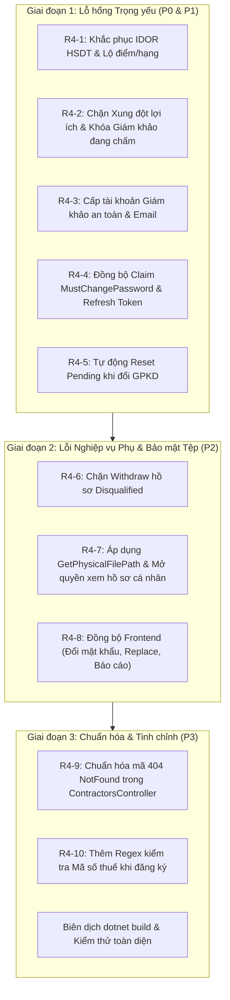

# BACKLOG KIỂM THỬ VÀ ĐÁNH GIÁ HỆ THỐNG - VÒNG 4 (ROUND 4 AUDIT)
Hệ thống Quản lý Đấu thầu & Theo dõi Hợp đồng (Procurement & Contract Tracking System)
*Thời gian lập: 16/10/2026*
*Căn cứ nghiệp vụ: Luật Đấu thầu 2023, Nghị định 24/2024/NĐ-CP, Tiêu chuẩn bảo mật OWASP ASVS & Kiểm soát quyền truy cập chi tiết (RBAC/ABAC).*

---

## 1. TỔNG QUAN VÒNG ĐÁNH GIÁ THỨ 4

Sau khi hoàn tất toàn bộ 11 hạng mục ở Round 3 (R3-1 đến R3-11), hệ thống đã đạt mức độ hoàn thiện cao ở phân hệ Chấm điểm, Quản lý Vòng đời Gói thầu và Nghiệm thu Hợp đồng. 
Đợt rà soát Round 4 tiến hành kiểm toán chuyên sâu toàn bộ các phân hệ còn lại:
1. **Phân hệ Hồ sơ Dự thầu (`BidSubmission`)**: Kiểm tra quyền truy cập tài liệu mật dự thầu và mức độ rò rỉ thông tin giá thầu / xếp hạng.
2. **Phân hệ Người dùng & Phân quyền (`User`, `Role`)**: Kiểm tra xung đột lợi ích theo Điều 6 Luật Đấu thầu và tính toàn vẹn của Hội đồng chấm thầu.
3. **Phân hệ Tổ Chuyên gia (`EvaluatorProposal`)**: Kiểm tra quy trình cấp phát tài khoản và bảo mật mật khẩu giám khảo.
4. **Phân hệ Xác thực & Middleware (`Auth`, `MustChangePasswordMiddleware`)**: Kiểm tra tính đồng bộ của JWT Claims và chu kỳ làm mới phiên làm việc.
5. **Phân hệ Quản lý Hồ sơ Năng lực (`Contractor`, `ProcuringEntity`)**: Kiểm tra quy trình thẩm định lại khi thay đổi giấy phép kinh doanh / hồ sơ pháp lý.
6. **Lưu trữ & Bảo mật File**: Kiểm tra phòng chống Path Traversal và giải phóng RAM khi tải tệp.
7. **Tích hợp Giao diện Người dùng (`Frontend React`)**: Đánh giá độ trễ đồng bộ giữa API Backend và Client Web.

---

## 2. BẢNG DANH MỤC FINDINGS ROUND 4 THEO PRIORITY

| Mã Backlog | Mức độ | Phân hệ | Tóm tắt sự cố / Lỗ hổng | Trạng thái |
| :---: | :---: | :--- | :--- | :---: |
| **R4-1** | 🔴 **P0** | `BidSubmission` | IDOR xem/tải HSDT trái thẩm quyền & Rò rỉ điểm/xếp hạng khi đang `Evaluating` (Bypass N14/N19). | ✅ Resolved |
| **R4-2** | 🟠 **P1** | `User` / `Role` | Xung đột lợi ích (gán chung vai trò Nhà thầu và Nội bộ); khóa/gỡ quyền giám khảo đang chấm thầu làm treo gói thầu; thiếu AuditLog. | ✅ Resolved |
| **R4-3** | 🟠 **P1** | `EvaluatorProposal` | Duyệt tạo tài khoản giám khảo không bật `MustChangePassword = true`, không gửi email; tách rời 2 lần `SaveChangesAsync`. | ✅ Resolved |
| **R4-4** | 🟠 **P1** | `Auth` / `Middleware` | Token JWT cũ bị kẹt claim `"MustChangePassword"` sau khi đổi mật khẩu; Middleware chặn nhầm `/api/auth/refresh-token`. | ✅ Resolved |
| **R4-5** | 🟠 **P1** | `Contractor` / `ProcuringEntity` | Tải GPKD mới không reset trạng thái về `"Pending"`; bế tắc không cho nộp/xét duyệt lại khi hồ sơ bị `"Rejected"`. | ✅ Resolved |
| **R4-6** | 🟡 **P2** | `BidSubmission` | Cho phép rút (`Withdraw`) cả HSDT đã bị loại (`Disqualified`) để xóa dấu vết nộp lại; trả sai HTTP Code 400 thay vì 403. | ⏳ Open (Teammate) |
| **R4-7** | 🟡 **P2** | `FileStorage` / `RBAC` | 4 API tải tệp chưa áp dụng `GetPhysicalFilePath` (nguy cơ Path Traversal); chặn chủ hồ sơ tự xem file pháp lý của mình. | ⏳ Open (Teammate) |
| **R4-8** | 🟡 **P2** | `Frontend` | Frontend chưa tích hợp màn hình đổi mật khẩu bắt buộc (`mustChangePassword`), thiếu API `replaceEvaluator` và 3 API báo cáo thống kê mới. | ⏳ Open (Teammate) |
| **R4-9** | 🟢 **P3** | `ContractorsController` | Trả về `400 BadRequest` thay vì `404 NotFound` khi không tìm thấy nhà thầu (sai lệch OpenAPI/Swagger). | ⏳ Open (Teammate) |
| **R4-10**| 🟢 **P3** | `Validation` | Thiếu Regex kiểm tra chuẩn định dạng Mã số thuế (`^\d{10}(-\d{3})?$`) khi Nhà thầu / Bên mời thầu đăng ký trực tuyến. | ⏳ Open (Teammate) |

---

## 3. NỘI DUNG CHI TIẾT TỪNG FINDING & HƯỚNG XỬ LÝ KỸ THUẬT

### 🔴 R4-1 (P0) – IDOR xem/tải HSDT trái thẩm quyền & Rò rỉ điểm số/xếp hạng khi gói thầu đang `Evaluating` [✅ ĐÃ XỬ LÝ & NGHIỆM THU]

- **Tệp tin liên quan:**
  - `ProcurementSystem.API/Controllers/BidSubmissionsController.cs` (Dòng 72-131, 199-226)
  - `ProcurementSystem.Infrastructure/Services/BidSubmissionService.cs` (Dòng 235-342, 366-380, 492-557)
- **Mô tả sự cố & Rủi ro:**
  1. **Lỗ hổng IDOR:** `BidSubmissionsController` kiểm tra `User.IsInRole("Evaluator") || User.IsInRole("Procurement")` và đặt cờ `isInternalStaff = true`. Tuy nhiên, `BidSubmissionService` không kiểm tra `Evaluator` đó có thực sự nằm trong danh sách Tổ chuyên gia (`BidPackageEvaluator.IsActive == true`) của gói thầu đó không, cũng không kiểm tra `Procurement` đó có phải là người lập gói thầu (`BidPackage.CreatedBy == userId`) không. Bất kỳ Giám khảo hoặc Bên mời thầu nào trong hệ thống cũng có thể xem toàn bộ giá dự thầu, tài liệu kỹ thuật và tải file đề xuất của mọi gói thầu khác.
  2. **Rò rỉ điểm số & thứ hạng (Vi phạm N14 & N19):** Dù ở Round 3 đã ẩn điểm tại `/rankings` và `/summary`, nhưng tại các API `GET /api/bid-submissions/{id}`, `GET /api/bid-submissions/package/{bidPackageId}` và `GET /api/bid-submissions/my-submissions`, trường `TotalScore` và `Rank` vẫn được trả về nguyên vẹn khi gói thầu đang ở trạng thái `Evaluating`. Cả Giám khảo và Nhà thầu dự thầu đều có thể theo dõi biến động điểm số và thứ tự xếp hạng trước khi có Quyết định phê duyệt trúng thầu.
- **Giải pháp kỹ thuật:**
  1. Trong `BidSubmissionService`:
     - Khi `Evaluator` gọi API xem hoặc tải HSDT: kiểm tra `_unitOfWork.Repository<BidPackageEvaluator>().Query().AnyAsync(e => e.BidPackageId == packageId && e.EvaluatorId == userId && e.IsActive)`. Nếu không có, từ chối với lỗi `403 Forbidden`.
     - Khi `Procurement` gọi API: kiểm tra `package.CreatedBy == userId` (trừ khi có role `Admin`).
  2. Ẩn trường dữ liệu nhạy cảm:
     - Nếu `BidPackage.Status == BidPackageStatus.Evaluating` và người gọi không phải `Admin` / `Procurement` sở hữu gói: gán `dto.TotalScore = null` và `dto.Rank = null` trong `GetSubmissionsByPackageAsync`, `GetSubmissionByIdAsync` và `GetMySubmissionsAsync`.
- **Kịch bản kiểm thử (Test Cases):**
  - [x] Giám khảo X (không thuộc Tổ chuyên gia gói Y) gọi `GET /api/bid-submissions/package/Y` $\rightarrow$ Nhận lỗi `403 Forbidden`.
  - [x] Giám khảo A (thuộc Tổ chuyên gia gói Y) gọi `GET /api/bid-submissions/package/Y` khi gói đang `Evaluating` $\rightarrow$ Xem được HSDT nhưng `TotalScore` và `Rank` đều bằng `null`.
  - [x] Nhà thầu Z gọi `GET /api/bid-submissions/my-submissions` khi gói đang `Evaluating` $\rightarrow$ Thấy trạng thái `Submitted`, nhưng `TotalScore` và `Rank` đều bằng `null`; khi gói chuyển sang `Awarded` $\rightarrow$ Thấy đầy đủ `TotalScore` và `Rank`.

---

### 🟠 R4-2 (P1) – Xung đột lợi ích (Điều 6 Luật Đấu thầu 2023), làm gãy Hội đồng chấm thầu khi đổi Role & Thiếu AuditLog [✅ ĐÃ XỬ LÝ & NGHIỆM THU]

- **Tệp tin liên quan:**
  - `ProcurementSystem.Infrastructure/Services/UserService.cs` (Dòng 108-193)
  - `ProcurementSystem.API/Controllers/UsersController.cs`
- **Mô tả sự cố & Rủi ro:**
  1. **Xung đột lợi ích (Điều 6, Điều 16 Luật Đấu thầu):** API `POST /api/users/{id}/roles` (`AssignRolesAsync`) cho phép Admin gán role `Contractor` đồng thời với `Evaluator` / `Procurement` / `Admin` cho cùng một tài khoản, hoặc gán role nội bộ cho người dùng đã có hồ sơ Nhà thầu liên kết trong bảng `Contractor`.
  2. **Gãy Hội đồng chấm thầu (Rule N4 & N15):** Khi Admin gỡ role `Evaluator` trong `AssignRolesAsync` hoặc khóa tài khoản (`ToggleUserStatusAsync`) của một chuyên gia đang ngồi trong Hội đồng chấm thầu của một gói thầu có trạng thái `Open` hoặc `Evaluating`, gói thầu sẽ rơi vào tình trạng bế tắc (deadlock), vì giám khảo bị khóa không thể đăng nhập nộp điểm, trong khi hệ thống yêu cầu 100% giám khảo active phải chấm đủ tiêu chí.
  3. **Tự tước quyền Admin:** `AssignRolesAsync` không chặn Admin tự gỡ role `Admin` của chính mình (`id == currentUserId`).
  4. **Thiếu AuditLog:** Cả 2 thao tác phân quyền và khóa tài khoản không tự động lọt vào `AuditSaveChangesInterceptor` (do không nằm trong danh sách 7 thực thể cốt lõi) và không được ghi nhận AuditLog thủ công.
- **Giải pháp kỹ thuật:**
  1. Trong `AssignRolesAsync`:
     - Kiểm tra nếu danh sách role mới chứa `Contractor` cùng với bất kỳ role nào trong `["Admin", "Procurement", "Evaluator"]` $\rightarrow$ Báo lỗi `400 BadRequest: "Tài khoản Nhà thầu không được phép kiêm nhiệm các vai trò quản lý hoặc đánh giá thầu."`
     - Kiểm tra nếu user đã có hồ sơ trong bảng `Contractors` mà Admin cố gán role nội bộ $\rightarrow$ Chặn với thông báo rõ ràng.
     - Chặn Admin tự gỡ bỏ role `Admin` của chính mình.
  2. Bảo vệ Hội đồng chấm thầu:
     - Trong cả `AssignRolesAsync` (nếu gỡ role `Evaluator`) và `ToggleUserStatusAsync` (nếu khóa tài khoản): kiểm tra xem user có đang là giám khảo active (`IsActive == true`) của bất kỳ gói thầu nào ở trạng thái `BidPackageStatus.Open` hoặc `BidPackageStatus.Evaluating` hay không. Nếu có $\rightarrow$ Chặn thao tác kèm thông báo: *"Người dùng đang tham gia Hội đồng chấm thầu của gói thầu #{Code}. Vui lòng thực hiện thay thế giám khảo (Replace Evaluator) trước khi khóa hoặc thu hồi quyền."*
  3. Bổ sung ghi `AuditLog` với `Action = "ASSIGN_USER_ROLES"` và `Action = "TOGGLE_USER_STATUS"`.
- **Kịch bản kiểm thử (Test Cases):**
  - [x] Gọi `AssignRolesAsync` gán role `["Contractor", "Evaluator"]` $\rightarrow$ Bị từ chối lỗi 400.
  - [x] Khóa tài khoản của Giám khảo đang chấm gói thầu `Evaluating` $\rightarrow$ Bị chặn với cảnh báo yêu cầu thay thế giám khảo trước.
  - [x] Admin tự gỡ role `Admin` của mình $\rightarrow$ Bị từ chối.
  - [x] Phân quyền hoặc đổi trạng thái người dùng thành công $\rightarrow$ Bản ghi `AuditLog` được lưu vào CSDL.

---

### 🟠 R4-3 (P1) – Cấp tài khoản Tổ chuyên gia không bật `MustChangePassword`, lộ mật khẩu tĩnh & Tách rời `SaveChangesAsync` [✅ ĐÃ XỬ LÝ & NGHIỆM THU]

- **Tệp tin liên quan:**
  - `ProcurementSystem.Infrastructure/Services/EvaluatorProposalService.cs` (Dòng 161-216, 228-343)
- **Mô tả sự cố & Rủi ro:**
  1. Khi Admin phê duyệt đề xuất Tổ chuyên gia (`ApproveProposalAsync`), Admin truyền mật khẩu tĩnh (`request.Password`). Bản ghi `User` được tạo với `MustChangePassword = false` (mặc định), và không có email nào được gửi cho giám khảo. Mật khẩu này được Bên mời thầu hoặc Admin bàn giao qua kênh không an toàn, vi phạm nghiêm trọng tính độc lập và bảo mật tài khoản chấm thầu (Rule N13).
  2. Tại `CreateProposalAsync` (Dòng 161 & 216), phương thức gọi `_unitOfWork.SaveChangesAsync()` 2 lần tách rời (lần 1 lưu đề xuất, lần 2 lưu Notification/AuditLog) mà không có `IDbContextTransaction`, vi phạm tính nguyên tử.
- **Giải pháp kỹ thuật:**
  1. Trong `ApproveProposalAsync`:
     - Nếu `string.IsNullOrWhiteSpace(request.Password)`: tự sinh mật khẩu ngẫu nhiên bảo mật 12 ký tự qua `RandomNumberGenerator`.
     - Luôn thiết lập `MustChangePassword = true` khi tạo tài khoản giám khảo mới.
     - Tích hợp `IEmailService.SendEmailAsync` gửi thông tin tài khoản và mật khẩu khởi tạo trực tiếp đến địa chỉ `proposal.Email` của giám khảo, kèm thông báo yêu cầu đổi mật khẩu ngay lần đăng nhập đầu tiên.
  2. Trong `CreateProposalAsync`: Gộp tất cả các thao tác `Add` thực thể (Proposal, Notification, AuditLog) và chỉ gọi `_unitOfWork.SaveChangesAsync()` duy nhất một lần ở cuối hàm.
- **Kịch bản kiểm thử (Test Cases):**
  - [x] Admin phê duyệt đề xuất bổ sung giám khảo mới $\rightarrow$ Tài khoản giám khảo có `MustChangePassword == true`, email thông báo được kích hoạt gửi đến chuyên gia.
  - [x] Giám khảo đăng nhập lần đầu bằng mật khẩu được cấp $\rightarrow$ Hệ thống yêu cầu đổi mật khẩu, không thể truy cập chấm thầu trước khi hoàn thành đổi mật khẩu.

---

### 🟠 R4-4 (P1) – Token JWT cũ bị kẹt Claim `"MustChangePassword"` sau khi đổi mật khẩu & Middleware chặn `/api/auth/refresh-token` [✅ ĐÃ XỬ LÝ & NGHIỆM THU]

- **Tệp tin liên quan:**
  - `ProcurementSystem.API/Program.cs` (Dòng 112-136)
  - `ProcurementSystem.API/Middlewares/MustChangePasswordMiddleware.cs` (Dòng 19-34)
  - `ProcurementSystem.Infrastructure/Services/AuthService.cs` (Dòng 215-224)
- **Mô tả sự cố & Rủi ro:**
  1. Khi người dùng có cờ `MustChangePassword = true` đăng nhập, `TokenService` gắn sẵn claim `"MustChangePassword": "true"` vào payload của Access Token JWT.
  2. Sau khi người dùng gọi `POST /api/auth/change-password` thành công (DB đã cập nhật `MustChangePassword = false`), nếu người dùng tiếp tục gửi kèm Access Token JWT cũ, `OnTokenValidated` trong `Program.cs` không chủ động gỡ bỏ claim này.
  3. Đặc biệt, `MustChangePasswordMiddleware` hiện chỉ whitelist đường dẫn `/api/auth/change-password` và `/api/auth/logout`, nhưng lại **chặn luôn `/api/auth/refresh-token`** (trả về lỗi 403). Người dùng bị kẹt hoàn toàn và buộc phải đăng xuất rồi đăng nhập lại từ đầu bằng tay.
- **Giải pháp kỹ thuật:**
  1. Cập nhật `MustChangePasswordMiddleware`: Bổ sung `/api/auth/refresh-token` vào danh sách `allowedPaths` (ngoài `change-password` và `logout`).
  2. Trong `AuthService.ChangePasswordAsync`: Ngay sau khi đổi mật khẩu thành công, tự động tạo và trả về luôn bộ Token mới (`TokenDto` bao gồm `AccessToken` không còn claim `MustChangePassword` và `RefreshToken` mới) thay vì chỉ trả về thông báo chuỗi rỗng.
  3. Trong `Program.cs` (`OnTokenValidated`): Nếu `user.MustChangePassword == false`, xóa bỏ mọi claim `"MustChangePassword"` hiện hữu trong `ClaimsIdentity`.
- **Kịch bản kiểm thử (Test Cases):**
  - [x] Tài khoản bị yêu cầu đổi mật khẩu gọi `POST /api/auth/change-password` $\rightarrow$ Nhận được bộ Access Token mới hợp lệ.
  - [x] Ngay lập tức gọi các API nghiệp vụ khác bằng Token mới $\rightarrow$ Truy cập thành công 200 OK mà không bị 403.
  - [x] Endpoint `/api/auth/refresh-token` không bị chặn bởi `MustChangePasswordMiddleware`.

---

### 🟠 R4-5 (P1) – Tải GPKD mới không reset trạng thái về `"Pending"` & Bế tắc không cho nộp/xét duyệt lại khi hồ sơ bị `"Rejected"` [✅ ĐÃ XỬ LÝ & NGHIỆM THU]

- **Tệp tin liên quan:**
  - `ProcurementSystem.Infrastructure/Services/ContractorService.cs` (Dòng 137-177)
  - `ProcurementSystem.Infrastructure/Services/ProcuringEntityService.cs`
  - `ProcurementSystem.API/Controllers/ProcuringEntitiesController.cs`
- **Mô tả sự cố & Rủi ro:**
  1. **Lỗ hổng kiểm soát hồ sơ Nhà thầu:** Trong `UpdateCurrentContractorProfileAsync`, khi nhà thầu đã được duyệt (`VerificationStatus == "Approved"`) tự tải lên một file Giấy phép kinh doanh (GPKD) mới, hệ thống xóa file cũ và ghi nhận file mới nhưng vẫn giữ nguyên `VerificationStatus = "Approved"`. Nhà thầu có thể lợi dụng điều này để thay đổi pháp nhân hoặc tải lên tài liệu giả mạo mà không qua thẩm định lại.
  2. **Bế tắc khi bị từ chối:** Nếu nhà thầu bị Admin từ chối (`VerificationStatus == "Rejected"`), khi họ tải lên file GPKD bổ sung/chỉnh sửa, trạng thái vẫn giữ nguyên `"Rejected"`, không chuyển về `"Pending"`, khiến Admin không biết để thẩm định lại.
  3. **Thiếu API Bên mời thầu:** Khi Bên mời thầu bị từ chối (`VerificationStatus == "Rejected"`), `ProcuringEntitiesController` hoàn toàn không có endpoint nào để Bên mời thầu cập nhật hồ sơ pháp lý / quyết định thành lập và gửi yêu cầu thẩm định lại.
- **Giải pháp kỹ thuật:**
  1. Trong `ContractorService.UpdateCurrentContractorProfileAsync`:
     - Nếu `request.BusinessLicenseFile != null` (có tải lên GPKD mới): tự động thiết lập `contractor.VerificationStatus = "Pending"`.
     - Ghi nhận `AuditLog` hành động `UPDATE_CONTRACTOR_LICENSE` và tạo `Notification` gửi tới tất cả tài khoản `Admin` để thông báo thẩm định lại hồ sơ nhà thầu.
  2. Trong phân hệ `ProcuringEntity`:
     - Bổ sung endpoint `PUT /api/procuring-entities/me` và phương thức `UpdateCurrentProfileAsync`: cho phép Bên mời thầu cập nhật lại thông tin, tệp quyết định thành lập / bổ nhiệm, và tự động chuyển `VerificationStatus = "Pending"` khi hồ sơ đang ở trạng thái `"Rejected"`.
- **Kịch bản kiểm thử (Test Cases):**
  - [x] Nhà thầu đang `Approved` tải lên GPKD mới $\rightarrow$ Trạng thái chuyển thành `Pending`, Admin nhận được thông báo yêu cầu thẩm định lại; nhà thầu tạm thời không thể nộp thầu gói mới cho đến khi được duyệt lại.
  - [x] Nhà thầu bị `Rejected` cập nhật GPKD mới $\rightarrow$ Chuyển về `Pending`.
  - [x] Bên mời thầu bị `Rejected` gọi `PUT /api/procuring-entities/me` cập nhật quyết định thành lập $\rightarrow$ Trạng thái chuyển về `Pending`.

---

### 🟡 R4-6 (P2) – Cho phép rút (`Withdraw`) cả HSDT đã bị loại (`Disqualified`) để xóa dấu vết nộp lại & Trả sai mã HTTP

- **Tệp tin liên quan:**
  - `ProcurementSystem.Infrastructure/Services/BidSubmissionService.cs` (Dòng 388-434)
  - `ProcurementSystem.API/Controllers/BidSubmissionsController.cs` (Dòng 172-190)
- **Mô tả sự cố & Rủi ro:**
  1. Phương thức `WithdrawSubmissionAsync` chỉ kiểm tra `if (submission.Status == BidSubmissionStatus.Withdrawn)`. Nếu một HSDT đã bị Hội đồng đánh giá truất quyền (`Disqualified`), nhà thầu vẫn có thể gọi API Rút hồ sơ dự thầu để chuyển trạng thái sang `Withdrawn`. Sau đó, họ lợi dụng logic nộp lại tại `SubmitBidAsync` (cho phép nộp lại nếu trạng thái là `Withdrawn`) để xóa sạch dấu vết bị loại khỏi hệ thống.
  2. Tại `BidSubmissionsController.WithdrawSubmission`, khi Service trả về kết quả lỗi kèm `result.StatusCode == 403` (ví dụ cố tình rút hồ sơ của doanh nghiệp khác), Controller vẫn gọi `return BadRequest(result)` (HTTP 400).
- **Giải pháp kỹ thuật:**
  1. Trong `BidSubmissionService.WithdrawSubmissionAsync`: Chỉ cho phép rút hồ sơ khi hồ sơ đang ở trạng thái hợp lệ duy nhất: `if (submission.Status != BidSubmissionStatus.Submitted) return Fail("Chỉ có thể rút hồ sơ dự thầu khi hồ sơ đang ở trạng thái Đã nộp (Submitted).");` (Chặn triệt để hồ sơ đã bị `Disqualified`, `Evaluated`, `Selected`, `Rejected`).
  2. Trong `BidSubmissionsController.WithdrawSubmission`: Trả về đúng mã trạng thái: `return StatusCode(result.StatusCode, result);`.
- **Kịch bản kiểm thử (Test Cases):**
  - [ ] Nhà thầu cố tình gọi `Withdraw` trên hồ sơ đã bị `Disqualified` $\rightarrow$ Bị từ chối với lỗi 400.
  - [ ] Nhà thầu A cố tình gọi `Withdraw` trên hồ sơ của Nhà thầu B $\rightarrow$ Nhận đúng mã lỗi `403 Forbidden`.

---

### 🟡 R4-7 (P2) – 4 API tải tệp chưa áp dụng `GetPhysicalFilePath` (Nguy cơ Path Traversal) & Chặn chủ hồ sơ xem tệp pháp lý

- **Tệp tin liên quan:**
  - `ProcurementSystem.API/Controllers/ContractorsController.cs` (Dòng 230-269 - `DownloadLicenseFile`)
  - `ProcurementSystem.Infrastructure/Services/ProcuringEntityService.cs` (Dòng 175-215) & `ProcuringEntitiesController.cs` (Dòng 132-168)
  - `ProcurementSystem.Infrastructure/Services/EvaluatorProposalService.cs` (Dòng 430-448 - `DownloadAppointmentFileAsync`)
  - `ProcurementSystem.Infrastructure/Services/BidSubmissionService.cs` (Dòng 528 - `GetSubmissionFileForDownloadAsync`)
- **Mô tả sự cố & Rủi ro:**
  1. Ở Round 3 (`R3-9`), phương thức an toàn `_fileStorageService.GetPhysicalFilePath(relativePath)` đã được phát triển để chuẩn hóa đường dẫn và triệt tiêu nguy cơ Path Traversal (`../`). Tuy nhiên, 4 vị trí trên vẫn dùng `Path.Combine(Directory.GetCurrentDirectory(), ...)` trực tiếp.
  2. Tại `ProcuringEntityService.cs`, hai hàm tải file vẫn dùng `File.ReadAllBytesAsync` để đọc toàn bộ tệp vào RAM server trước khi trả về `byte[]`, gây lãng phí bộ nhớ khi nhiều người dùng tải tài liệu đồng thời.
  3. Endpoint `GET /api/contractors/{id}/license-file` và các endpoint tải file pháp lý của Bên mời thầu hiện đang khóa cứng `[Authorize(Roles = "Admin")]`. Do đó, chính Nhà thầu hoặc Bên mời thầu tạo hồ sơ lại không có quyền tải/xem lại tài liệu mình đã đính kèm; cán bộ Bên mời thầu (`Procurement`) cũng không xem được GPKD của nhà thầu để đối chiếu năng lực dự thầu.
- **Giải pháp kỹ thuật:**
  1. Thay thế toàn bộ `Path.Combine` bằng `_fileStorageService.GetPhysicalFilePath(relativePath)`.
  2. Thay thế việc đọc `ReadAllBytesAsync` sang trả về đường dẫn vật lý và sử dụng `PhysicalFile(physicalPath, contentType, fileName)` để truyền tệp dạng luồng (Streaming).
  3. Cập nhật phân quyền:
     - `GET /api/contractors/{id}/license-file`: Cho phép `Roles = "Admin,Procurement"` và chính `Contractor` sở hữu hồ sơ đó (`contractor.UserId == currentUserId`).
     - `GET /api/procuring-entities/{id}/*-file`: Cho phép `Roles = "Admin"` và chính `Procurement` đại diện bên mời thầu đó (`entity.UserId == currentUserId`).
- **Kịch bản kiểm thử (Test Cases):**
  - [ ] Nhà thầu tự tải lại file GPKD của chính mình qua `/api/contractors/{myId}/license-file` $\rightarrow$ Thành công 200 OK.
  - [ ] Cán bộ Bên mời thầu tải file GPKD của nhà thầu để thẩm định $\rightarrow$ Thành công 200 OK.
  - [ ] Thử nghiệm truyền chuỗi đường dẫn tương đối có chứa `../` $\rightarrow$ `GetPhysicalFilePath` chặn đứng và trả về lỗi an toàn.

---

### 🟡 R4-8 (P2) – Frontend chưa đồng bộ các tính năng mới của Round 3 Backend

- **Tệp tin liên quan:**
  - `frontend/src/api/authApi.js` & `frontend/src/pages/auth/LoginPage.jsx`
  - `frontend/src/api/bidPackageApi.js`
  - `frontend/src/api/reportApi.js`
- **Mô tả sự cố & Rủi ro:**
  1. **Luồng bắt buộc đổi mật khẩu:** Khi các tài khoản Nhà thầu được import từ Excel hoặc Giám khảo được cấp tài khoản đăng nhập trên giao diện web, Backend trả về cờ `mustChangePassword: true` và chặn mọi API khác (`403 MUST_CHANGE_PASSWORD`). Tuy nhiên, `authApi.js` chưa có hàm `changePassword` và Frontend chưa có Modal/Trang đổi mật khẩu, khiến người dùng bị kẹt màn hình trắng hoặc không thao tác được.
  2. **Thiếu API Thay thế giám khảo:** Backend đã hoàn thiện `POST /api/bid-packages/{id}/evaluators/replace`, nhưng `bidPackageApi.js` chưa bổ sung hàm `replaceEvaluator(packageId, data)`.
  3. **Chưa kết nối 3 API Báo cáo thống kê mới:** `reportApi.js` chưa khai báo và gọi 3 endpoint báo cáo: `getProcurementSummary(params)`, `getContractorPerformance(params)`, và `getContractsProgress(params)`.
- **Giải pháp kỹ thuật:**
  1. Trong `frontend/src/api/authApi.js`: Bổ sung `changePassword: (data) => axiosClient.post('/auth/change-password', data)`.
  2. Trong `frontend/src/pages/auth/LoginPage.jsx` hoặc `AuthContext`: Kiểm tra nếu `response.data.user.mustChangePassword === true`, tự động chuyển hướng người dùng tới màn hình Đổi mật khẩu lần đầu (bắt buộc nhập mật khẩu hiện tại và mật khẩu mới).
  3. Trong `frontend/src/api/bidPackageApi.js`: Bổ sung `replaceEvaluator: (packageId, data) => axiosClient.post(`/bid-packages/${packageId}/evaluators/replace`, data)`.
  4. Trong `frontend/src/api/reportApi.js`: Khai báo 3 phương thức truy vấn báo cáo mới và tích hợp hiển thị vào giao diện Thống kê Báo cáo.
- **Kịch bản kiểm thử (Test Cases):**
  - [ ] Đăng nhập bằng tài khoản vừa import từ Excel trên giao diện Web $\rightarrow$ Tự động chuyển đến màn hình Đổi mật khẩu lần đầu.
  - [ ] Đổi mật khẩu thành công trên giao diện $\rightarrow$ Đăng nhập vào Dashboard bình thường mà không gặp lỗi 403.
  - [ ] Giao diện quản lý Tổ chuyên gia có nút "Thay thế giám khảo" và gọi API thành công.

---

### 🟢 R4-9 (P3) – Chuẩn hóa HTTP Status Code (`404 NotFound` thay vì `400 BadRequest`) tại ContractorsController

- **Tệp tin liên quan:**
  - `ProcurementSystem.API/Controllers/ContractorsController.cs` (Dòng 174-180, 213-219, 284-290)
- **Mô tả sự cố & Rủi ro:**
  - Khi truyền một `id` nhà thầu không tồn tại vào các API: `PATCH /api/contractors/{id}/rating`, `PATCH /api/contractors/{id}/verify`, hoặc `POST /api/contractors/{id}/recalculate-rating`, Service trả về thông báo lỗi "Không tìm thấy nhà thầu". Tuy nhiên Controller lại trả về `BadRequest(result)` (HTTP 400).
  - Điều này vi phạm đặc tả OpenAPI/Swagger đã khai báo `[ProducesResponseType(StatusCodes.Status404NotFound)]` và gây khó khăn cho việc xử lý lỗi ở phía Frontend.
- **Giải pháp kỹ thuật:**
  - Trong các action trên của `ContractorsController`: Kiểm tra `if (!result.Success && result.Message.Contains("Không tìm thấy")) return NotFound(result); else if (!result.Success) return BadRequest(result);` hoặc chuẩn hóa thông qua trường `StatusCode` trong `ApiResponse`.
- **Kịch bản kiểm thử (Test Cases):**
  - [ ] Gọi `PATCH /api/contractors/999999/rating` $\rightarrow$ Trả về đúng HTTP `404 Not Found`.

---

### 🟢 R4-10 (P3) – Đồng bộ Regex kiểm tra định dạng Mã số thuế (`TaxCode`) khi đăng ký trực tuyến

- **Tệp tin liên quan:**
  - `ProcurementSystem.Infrastructure/Services/ContractorAuthService.cs`
  - `ProcurementSystem.Core/DTOs/Contractor/RegisterContractorRequest.cs`
  - `ProcurementSystem.Core/DTOs/ProcuringEntity/CreateProcuringEntityRequest.cs`
- **Mô tả sự cố & Rủi ro:**
  - Khi nhập nhà thầu từ file Excel (`ImportContractorsFromExcelAsync`), hệ thống đã áp dụng Regex chuẩn Việt Nam `^\d{10}(-\d{3})?$` để xác thực mã số thuế (10 chữ số cho doanh nghiệp hoặc 13 chữ số có dấu gạch ngang cho chi nhánh).
  - Tuy nhiên, trong DTO đăng ký trực tuyến tài khoản Nhà thầu và Bên mời thầu, trường `TaxCode` chỉ được giới hạn `[MaxLength(50)]`, cho phép người dùng nhập chữ cái hoặc ký tự đặc biệt tùy ý.
- **Giải pháp kỹ thuật:**
  - Thêm thuộc tính `[RegularExpression(@"^\d{10}(-\d{3})?$", ErrorMessage = "Mã số thuế không đúng định dạng chuẩn (10 chữ số hoặc 13 chữ số dạng xxxxxxxxxx-xxx).")]` vào các DTO đăng ký và cập nhật hồ sơ Nhà thầu / Bên mời thầu.
- **Kịch bản kiểm thử (Test Cases):**
  - [ ] Đăng ký Nhà thầu với MST `"12345ABC"` $\rightarrow$ Bị từ chối ngay tại tầng Model Validation với mã lỗi 400.
  - [ ] Đăng ký với MST `"0101234567"` hoặc `"0101234567-001"` $\rightarrow$ Hợp lệ.

---

## 4. QUY TẮC BỔ SUNG CHO AGENT & LẬP TRÌNH VIÊN (AGENT RULES N20 - N26)

Để đảm bảo việc sửa mã nguồn ở Vòng 4 chính xác, không gây lỗi hồi quy (regression) và tuân thủ chặt chẽ Luật Đấu thầu 2023, Agent cần tuân thủ các quy tắc sau:

| # | Mã Quy tắc | Nội dung quy tắc bắt buộc |
|---|---|---|
| 1 | **N20** | **Kiểm soát Truy cập HSDT Chi tiết (Fine-grained IDOR Prevention):** Cán bộ nội bộ (`Evaluator`, `Procurement`) chỉ được phép xem danh sách, xem chi tiết và tải tệp HSDT khi và chỉ khi: là thành viên active trong Hội đồng chấm thầu của gói đó (`BidPackageEvaluator.IsActive == true`), hoặc là người khởi tạo gói thầu (`CreatedBy == userId`), hoặc là `Admin`. Tuyệt đối không dùng cờ generic `isInternalStaff` mà không gắn liền với `packageId` cụ thể. |
| 2 | **N21** | **Bảo vệ Điểm số & Xếp hạng Tuyệt đối trước Quyết định Trao thầu:** Trong thời gian gói thầu có trạng thái `Evaluating`, trường `TotalScore` và `Rank` phải được ẩn (`null` hoặc `0`) ở **tất cả** các endpoint trả về dữ liệu nộp thầu (`/submissions`, `/submissions/{id}`, `/my-submissions`, `/rankings`, `/summary`) đối với cả Giám khảo và Nhà thầu. Chỉ công khai điểm số khi gói thầu đã chuyển sang `Awarded` hoặc `Completed`. |
| 3 | **N22** | **Ngăn ngừa Xung đột Lợi ích (Điều 6 Luật Đấu thầu 2023):** Tuyệt đối không cho phép tài khoản có vai trò `Contractor` (hoặc liên kết hồ sơ nhà thầu) được cấp các quyền `Evaluator`, `Procurement` hoặc `Admin`. Không cho phép gỡ vai trò hoặc khóa tài khoản của giám khảo đang có phân công chấm thầu active tại các gói thầu đang `Open` hoặc `Evaluating` (bắt buộc phải thực hiện thủ tục thay thế giám khảo `replaceEvaluator` trước). |
| 4 | **N23** | **Cấp phát Tài khoản Giám khảo An toàn (Zero Plaintext Password Exposure):** Khi phê duyệt đề xuất bổ sung giám khảo mới, bắt buộc phải kích hoạt cờ `MustChangePassword = true`, tự sinh mật khẩu ngẫu nhiên an toàn nếu không truyền vào, và gửi thông tin qua email trực tiếp cho chuyên gia. |
| 5 | **N24** | **Tính Nhất quán Thẩm định Hồ sơ Pháp lý:** Mọi hành vi cập nhật Giấy phép kinh doanh (đối với Nhà thầu) hoặc Quyết định thành lập / bổ nhiệm (đối với Bên mời thầu) đều phải tự động đưa `VerificationStatus` về `"Pending"`, phát sinh `Notification` cho Admin và ghi nhận `AuditLog` để thẩm định lại. |
| 6 | **N25** | **Bảo toàn Lịch sử Kỷ luật HSDT:** Hồ sơ dự thầu đã bị truất quyền (`Disqualified`) tuyệt đối không được phép rút hồ sơ (`Withdraw`). Thao tác rút hồ sơ chỉ có hiệu lực duy nhất khi HSDT đang ở trạng thái `Submitted`. |
| 7 | **N26** | **Chuẩn hóa Tải Tệp An toàn & Chống Cạn kiệt Tài nguyên RAM:** 100% các API tải tệp đính kèm trong hệ thống phải đi qua hàm chuẩn hóa an toàn `_fileStorageService.GetPhysicalFilePath(relativePath)` để chống Path Traversal (`../`), và trả về kết quả bằng luồng `PhysicalFile`, cấm sử dụng `File.ReadAllBytesAsync` gây tràn bộ nhớ. |

---

## 5. KẾ HOẠCH & THỨ TỰ THỰC HIỆN ĐỀ XUẤT

1. **Bước 1 (Ưu tiên cao nhất - P0 & P1):** Hoàn thành lần lượt `R4-1` $\rightarrow$ `R4-2` $\rightarrow$ `R4-3` $\rightarrow$ `R4-4` $\rightarrow$ `R4-5`.
2. **Bước 2 (Ưu tiên trung bình - P2):** Hoàn thành `R4-6` $\rightarrow$ `R4-7` $\rightarrow$ `R4-8`.
3. **Bước 3 (Ưu tiên thấp & Tinh chỉnh - P3):** Hoàn thành `R4-9` $\rightarrow$ `R4-10`.
4. **Bước 4 (Nghiệm thu):** Chạy lệnh kiểm tra biên dịch `dotnet build ProcurementSystem.slnx`, chạy kiểm thử luồng nghiệp vụ và cập nhật tài liệu nghiệm thu.
