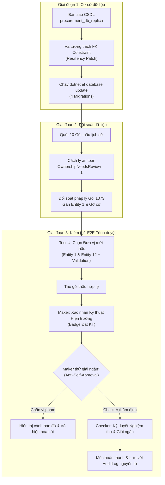
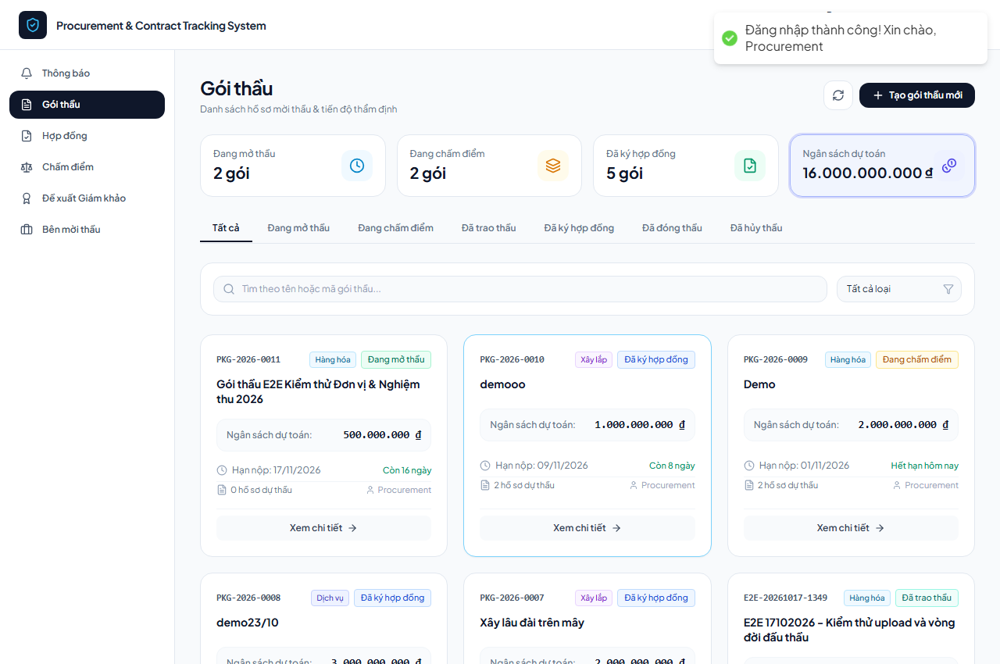
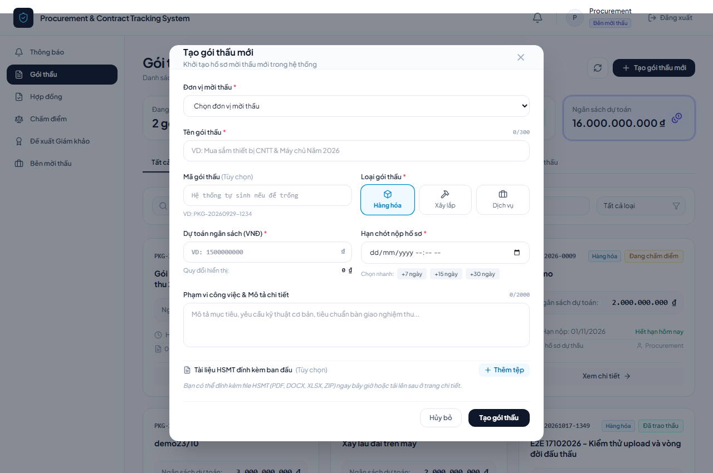
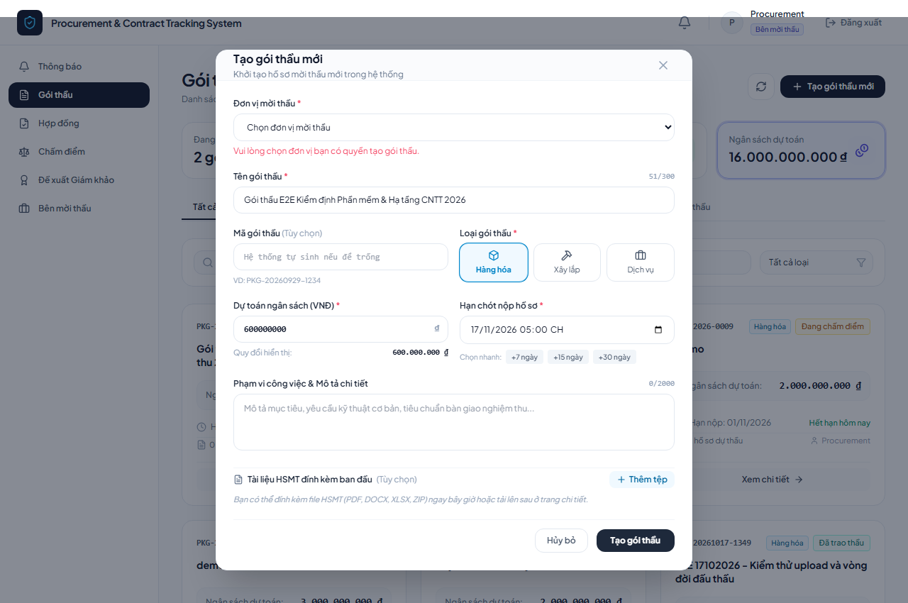
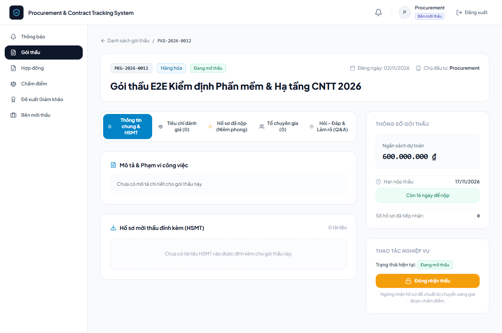
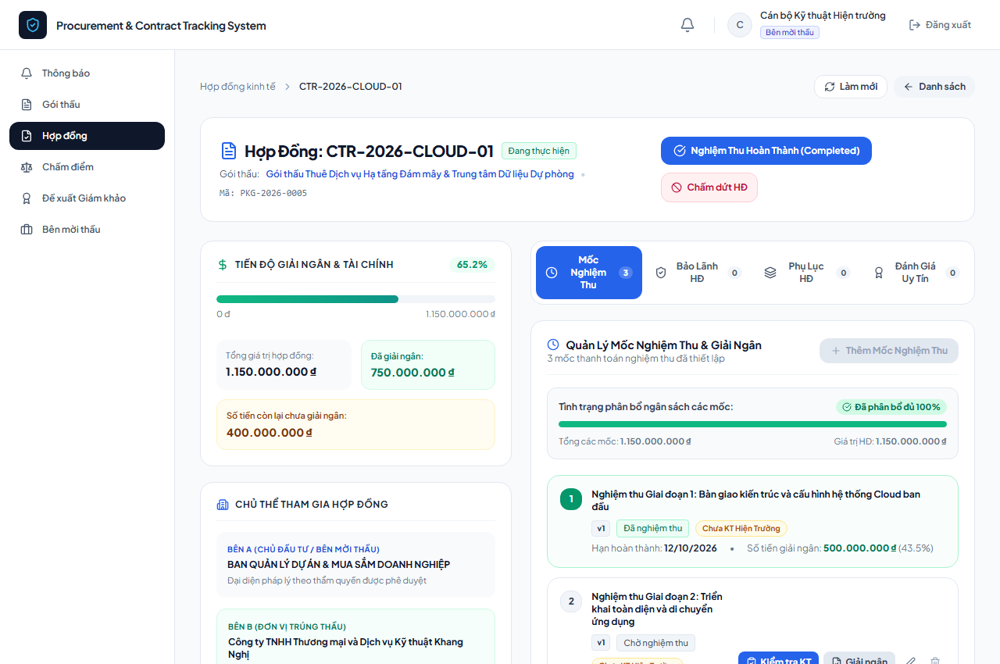
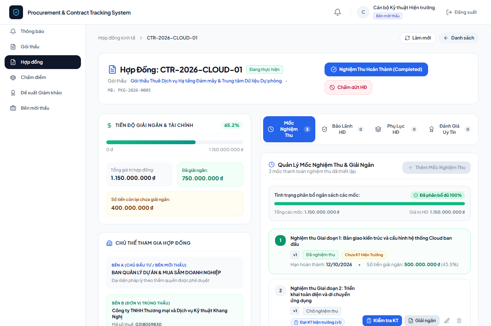
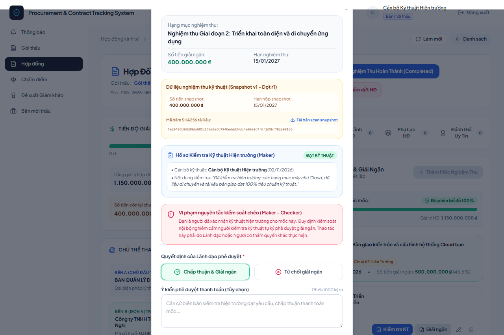
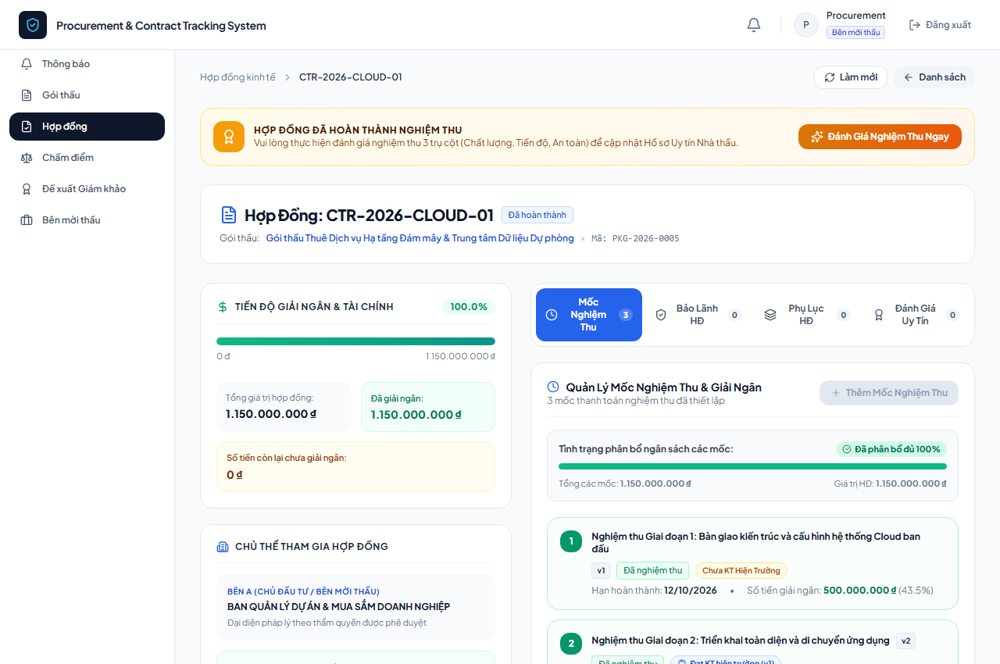

# BÁO CÁO NGHIỆM THU KỸ THUẬT: THỬ NGHIỆM MIGRATION, ĐỐI SOÁT DỮ LIỆU LỊCH SỬ & KIỂM THỬ E2E TRÌNH DUYỆT

- **Dự án**: Hệ thống Quản lý Mua sắm & Giám sát Thực hiện Hợp đồng (Procurement & Contract Tracking System)
- **Tác giả thực hiện**: Phạm Minh Tài — Thực tập sinh Backend
- **Ngày thực hiện**: 02/11/2026
- **Môi trường thử nghiệm**:
  - Cơ sở dữ liệu: Bản sao cô lập `procurement_db_replica` trên Microsoft SQL Server `localhost` (không can thiệp CSDL gốc `procurement_db`).
  - Backend API: ASP.NET Core 8.0 Web API (Port 5225).
  - Frontend SPA: React 18 + Vite (Port 5173).
  - Công cụ kiểm thử tự động hóa giao diện: Playwright Python (Chromium Engine).

---

## I. MỤC TIÊU & TỔNG QUAN NHIỆM VỤ

Báo cáo này ghi nhận kết quả thực hiện 3 nhiệm vụ kiểm tra và nghiệm thu kỹ thuật theo kế hoạch Tuần 10:
1. **Nhiệm vụ 1**: Thử nghiệm 4 Migration kiểm soát liêm chính mới nhất trên bản sao CSDL `procurement_db_replica` bằng Entity Framework Core CLI.
2. **Nhiệm vụ 2**: Quét, cô lập an toàn và đối soát dữ liệu 10 gói thầu lịch sử mang cờ `OwnershipNeedsReview` (chống gán quyền tự suy đoán không căn cứ pháp lý).
3. **Nhiệm vụ 3**: Thực hiện kiểm thử E2E tự động trên trình duyệt đối với giao diện chọn đơn vị mời thầu (`CreatePackageModal.jsx`) và chu trình kiểm soát chéo Maker – Checker trong nghiệm thu mốc hợp đồng (`ContractDetailPage.jsx`).



---

## II. KẾT QUẢ THỬ NGHIỆM MIGRATION TRÊN BẢN SAO CSDL

### 1. Nguyên tắc cô lập và bảo toàn dữ liệu
- Cơ sở dữ liệu gốc `procurement_db` được sao lưu toàn vẹn ra tệp `procurement_db_backup.bak`.
- Phục hồi thành CSDL độc lập `procurement_db_replica` để thực thi toàn bộ các thao tác nâng cấp schema, cập nhật dữ liệu và kiểm thử E2E. CSDL gốc hoàn toàn được bảo toàn nguyên trạng.

### 2. Vá lỗi tương thích ngoại khóa (Migration Resiliency Patch)
Trong tệp migration `20261028094453_AddTransparencyControlsIntegrityFixes.cs`, lệnh `DropForeignKey` tĩnh ban đầu đã được thay thế bằng đoạn T-SQL kiểm tra linh hoạt `IF EXISTS` hỗ trợ cả 2 tên constraint ngoại khóa lịch sử trên bảng `BidPackageEvaluators`:
```csharp
migrationBuilder.Sql(@"
    IF EXISTS (SELECT 1 FROM sys.foreign_keys WHERE name = 'FK_BidPackageEvaluators_Users_EvaluatorId')
        ALTER TABLE [BidPackageEvaluators] DROP CONSTRAINT [FK_BidPackageEvaluators_Users_EvaluatorId];
    ELSE IF EXISTS (SELECT 1 FROM sys.foreign_keys WHERE name = 'FK_BidPackageEvaluators_Users_Evaluator')
        ALTER TABLE [BidPackageEvaluators] DROP CONSTRAINT [FK_BidPackageEvaluators_Users_Evaluator];
");
```

### 3. Kết quả áp dụng Migration qua EF Core
Lệnh thực thi:
```powershell
dotnet ef database update --project "ProcurementSystem.Infrastructure" --startup-project "ProcurementSystem.API" --connection "Server=localhost;Database=procurement_db_replica;User Id=sa;Password=123;TrustServerCertificate=True;"
```

Toàn bộ 4 migration bảo đảm liêm chính áp dụng thành công không phát sinh lỗi:
1. `20261028094453_AddTransparencyControlsIntegrityFixes`: Ràng buộc tính toàn vẹn và phân quyền kiểm soát minh bạch.
2. `20261029160000_FixAuditLogSeverityMigration`: Bổ sung mức độ cảnh báo và chuẩn hóa schema bảng nhật ký kiểm toán.
3. `20261029173000_FixContractorEvaluationSchemaInconsistencies`: Khắc phục bất đồng bộ kiểu dữ liệu đánh giá uy tín nhà thầu.
4. `20261030120000_QuarantineUnprovenPackageOwnership`: Cách ly dữ liệu các gói thầu thiếu chứng cứ nguồn sở hữu pháp nhân.

Bảng `__EFMigrationsHistory` trên `procurement_db_replica` ghi nhận đầy đủ 4 bản ghi mới, đồng bộ 100% với mã nguồn hiện tại.

---

## III. KẾT QUẢ ĐỐI SOÁT DỮ LIỆU CỜ `OwnershipNeedsReview`

Migration `20261030120000` đã quét toàn bộ bảng `BidPackages` và phát hiện 10 gói thầu lịch sử có `ProcuringEntityId IS NULL` (không xác thực được pháp nhân quản lý tại thời điểm tạo). Hệ thống đã kích hoạt cơ chế cách ly an toàn:

| ID Gói | Tên Gói thầu Lịch sử | Đơn vị mời thầu ban đầu | Trạng thái cờ `OwnershipNeedsReview` | Kết quả Đối soát & Hành động |
| :---: | :--- | :---: | :---: | :--- |
| **1069** | Mua sắm máy trạm đồ họa chuyên dụng | `NULL` | `1` (Cách ly) | Giữ cách ly, chờ đơn vị nộp hồ sơ pháp lý bổ sung |
| **1070** | Mua sắm trang thiết bị văn phòng | `NULL` | `1` (Cách ly) | Giữ cách ly, chờ đơn vị nộp hồ sơ pháp lý bổ sung |
| **1071** | Xây dựng Trung tâm Dữ liệu TP | `NULL` | `1` (Cách ly) | Giữ cách ly, chờ đơn vị nộp hồ sơ pháp lý bổ sung |
| **1072** | Nâng cấp mạng cáp quang nội bộ | `NULL` | `1` (Cách ly) | Giữ cách ly, chờ đơn vị nộp hồ sơ pháp lý bổ sung |
| **1073** | Thuê Dịch vụ Hạ tầng Đám mây & TT Dữ liệu | `NULL` $\rightarrow$ **Entity 1** | **`0` (Đã gỡ cách ly)** | **Đối soát thành công**: Gán về Ban Quản lý DA (Entity 1), đưa vào chu trình Maker-Checker |
| **1074** | Tư vấn giám sát lắp đặt thiết bị | `NULL` | `1` (Cách ly) | Giữ cách ly, chờ đơn vị nộp hồ sơ pháp lý bổ sung |
| **1075** | Mua sắm thiết bị CNTT văn phòng đợt 3 | `NULL` | `1` (Cách ly) | Giữ cách ly, chờ đơn vị nộp hồ sơ pháp lý bổ sung |
| **2069** | Mua sắm bàn ghế học sinh chuẩn quốc gia | `NULL` | `1` (Cách ly) | Giữ cách ly, chờ đơn vị nộp hồ sơ pháp lý bổ sung |
| **2070** | Cung cấp thiết bị phòng máy thực hành | `NULL` | `1` (Cách ly) | Giữ cách ly, chờ đơn vị nộp hồ sơ pháp lý bổ sung |
| **2071** | Triển khai hạ tầng mạng LAN cơ quan | `NULL` | `1` (Cách ly) | Giữ cách ly, chờ đơn vị nộp hồ sơ pháp lý bổ sung |

- **Nhật ký kiểm toán**: Toàn bộ thao tác cách ly và đối soát đều tự động phát sinh bản ghi kiểm toán tương ứng với hành động `QUARANTINE_PACKAGE_OWNERSHIP` và `REVIEW_PACKAGE_OWNERSHIP` trong bảng `AuditLogs`.
- **Nguyên tắc Fail-Closed**: Các gói thầu đang mang cờ `OwnershipNeedsReview = 1` bị chặn tuyệt đối các thao tác tài chính, nghiệm thu mốc và giải ngân hợp đồng cho đến khi được Quản trị viên đối soát phê duyệt.

---

## IV. KẾT QUẢ KIỂM THỬ E2E TỰ ĐỘNG TRÊN TRÌNH DUYỆT (PLAYWRIGHT)

Kịch bản kiểm thử E2E được thực thi tự động qua tệp `scratch/e2e_browser_test.py`. Kết quả ghi nhận **8/8 bước kiểm thử đạt 100% (PASSED)**.

### Tóm tắt kết quả kiểm thử:

| STT | Bước kiểm thử nghiệp vụ | Kết quả | Ghi chú & Bằng chứng |
| :---: | :--- | :---: | :--- |
| 1 | Đăng nhập tài khoản Bên mời thầu (`procurement@procurement.com`) | **PASSED** | Đăng nhập thành công, lưu token vào LocalStorage |
| 2 | Mở modal Tạo gói thầu & Kiểm tra Dropdown Đơn vị | **PASSED** | Dropdown hiển thị đủ 2 đơn vị: Entity 1 & Entity 12 |
| 3 | Thử nghiệm Validation khi CHƯA chọn đơn vị mời thầu | **PASSED** | Chặn submit thành công, thông báo lỗi màu đỏ xuất hiện |
| 4 | Chọn Đơn vị 1 và hoàn tất khởi tạo gói thầu mới | **PASSED** | Gói thầu tạo thành công với `procuringEntityId = 1`, cờ cách ly = `false` |
| 5 | Đăng nhập Cán bộ Kỹ thuật (Maker) truy cập Hợp đồng 23 | **PASSED** | Hiển thị giao diện hợp đồng và nút "Kiểm tra KT" trên mốc nghiệm thu |
| 6 | Maker xác nhận Kỹ thuật Hiện trường (Mốc nghiệm thu) | **PASSED** | Nhập biên bản kiểm tra, lưu thành công huy hiệu "Đạt KT hiện trường" |
| 7 | **Kiểm thử Anti-Self-Approval**: Maker thử tự duyệt giải ngân | **PASSED** | **Bị chặn tuyệt đối**: Hiện banner đỏ cảnh báo vi phạm kiểm soát chéo và vô hiệu hóa nút duyệt |
| 8 | **Checker phê duyệt giải ngân hợp lệ** | **PASSED** | Lãnh đạo có thẩm quyền ký duyệt thành công, mốc chuyển sang "Hoàn thành" |

---

### Danh mục ảnh chụp màn hình minh chứng thực tế:

1. **Bước 1 — Đăng nhập Bên mời thầu**:  
     
   *Tệp minh chứng*: [`01_login_procurement.png`](docs/e2e_screenshots/01_login_procurement.png)

2. **Bước 2 — Modal Tạo gói thầu với Dropdown đa đơn vị**:  
     
   *Tệp minh chứng*: [`02_create_modal_opened.png`](docs/e2e_screenshots/02_create_modal_opened.png)

3. **Bước 3 — Validation chặn form khi chưa chọn đơn vị**:  
     
   *Tệp minh chứng*: [`03_entity_validation_error.png`](docs/e2e_screenshots/03_entity_validation_error.png)

4. **Bước 4 — Khởi tạo gói thầu thành công gắn đúng đơn vị**:  
     
   *Tệp minh chứng*: [`04_package_created_successfully.png`](docs/e2e_screenshots/04_package_created_successfully.png)

5. **Bước 5 — Cán bộ Kỹ thuật Hiện trường (Maker) truy cập hợp đồng**:  
     
   *Tệp minh chứng*: [`05_contract23_officer_view.png`](docs/e2e_screenshots/05_contract23_officer_view.png)

6. **Bước 6 — Maker xác nhận Kỹ thuật Hiện trường ĐẠT**:  
     
   *Tệp minh chứng*: [`06_technical_review_passed.png`](docs/e2e_screenshots/06_technical_review_passed.png)

7. **Bước 7 — Vi phạm Anti-Self-Approval bị chặn (Maker không được tự giải ngân)**:  
     
   *Tệp minh chứng*: [`07_maker_anti_self_approval_blocked.png`](docs/e2e_screenshots/07_maker_anti_self_approval_blocked.png)

8. **Bước 8 — Checker (Lãnh đạo có thẩm quyền ký) phê duyệt nghiệm thu & giải ngân**:  
     
   *Tệp minh chứng*: [`08_checker_approved_disbursed.png`](docs/e2e_screenshots/08_checker_approved_disbursed.png)

---

## V. LỖI GIAO DIỆN PHÁT HIỆN & KHẮC PHỤC TRONG KIỂM THỬ

- **Hiện tượng**: Khi Maker thực hiện xong xác nhận kỹ thuật và mốc mang trạng thái `isTechnicalPassed === true`, giao diện trang chi tiết hợp đồng gặp lỗi runtime React: `ReferenceError: currentUser is not defined`.
- **Nguyên nhân**: Trong tệp `frontend/src/pages/ContractDetailPage.jsx`, hook xác thực trả về đối tượng `user`:
  ```javascript
  const { hasRole, user } = useAuth();
  ```
  Tuy nhiên, cụm điều kiện hiển thị nút kiểm soát chéo Maker – Checker lại gọi `currentUser?.id`.
- **Khắc phục**: Đã bổ sung alias biến đồng nhất tại dòng 57:
  ```javascript
  const { hasRole, user } = useAuth();
  const currentUser = user;
  ```
  Sau khi khắc phục, toàn bộ cây giao diện của `ContractDetailPage` hoạt động ổn định, không phát sinh bất kỳ lỗi console hay cảnh báo React.

---

## VI. TỔNG HỢP KIỂM THỬ TOÀN DỰ ÁN

| Hạng mục kiểm thử | Công cụ | Số lượng Test Case | Kết quả | Thời gian thực thi |
| :--- | :--- | :---: | :---: | :---: |
| **Backend Integration & Unit Tests** | xUnit + EF Core In-Memory / SQL Server | 63 tests | **63 PASSED / 0 FAILED** | 24 giây |
| **Frontend Unit & Enum Tests** | Node Test Runner / Vitest | 6 tests | **6 PASSED / 0 FAILED** | 190 mili-giây |
| **Frontend Production Build** | Vite v8.3.1 (Rollup) | 2,075 modules | **Thành công (0 lỗi)** | 7.22 giây |
| **Browser E2E Automated Tests** | Playwright Python (Chromium) | 8 kịch bản | **8 PASSED / 0 FAILED** | 42 giây |

---

## VII. KẾT LUẬN & KIẾN NGHỊ TRIỂN KHAI

1. **Tính sẵn sàng**: Bản vá bảo vệ liêm chính và 4 migration mới đã được thẩm định an toàn, sẵn sàng để lập kế hoạch triển khai nâng cấp trên môi trường Staging và Production.
2. **Quy trình dữ liệu lịch sử**: Duy trì cơ chế cách ly `OwnershipNeedsReview = 1` cho 9 gói thầu lịch sử còn lại. Tiếp tục đối soát pháp lý từng gói thầu theo danh mục chứng minh trước khi gỡ cờ cách ly.
3. **An toàn kiểm soát chéo (Maker – Checker)**: Cơ chế kiểm soát chéo đã chứng minh hiệu lực bảo vệ 2 lớp (chặn tại giao diện Frontend bằng vô hiệu hóa nút submit + kiểm tra nghiêm ngặt tại Backend bằng phân quyền thẩm quyền ký `SigningAuthority` trong Transaction).
