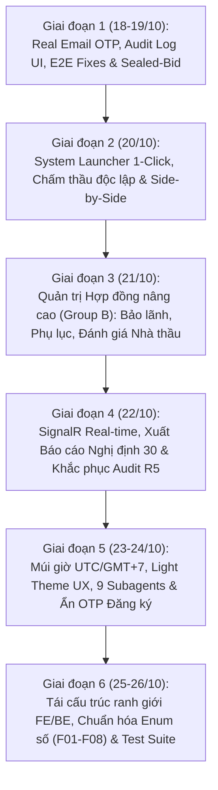

# TÀI LIỆU BÀN GIAO CÔNG VIỆC DỰ ÁN (PROJECT HANDOFF DOCUMENT)
## HỆ THỐNG MUA SẮM & ĐẤU THẦU ĐIỆN TỬ (PROCUREMENT & CONTRACT TRACKING SYSTEM)
**Thời gian bàn giao:** 26/10/2026  
**Phạm vi bàn giao:** Toàn bộ công việc, tính năng, kiến trúc và kiểm thử thực hiện từ ngày **18/10/2026** đến ngày **26/10/2026**  
**Người thực hiện bàn giao:** Phạm Minh Tài (Thực tập sinh Backend)  
**Nhánh làm việc chính (Source of Truth):** `dev`  
**Baseline Commit SHA (trước 18/10):** `b8f566130b2204bfbb5a07662fa9b35781a7691e`  
**HEAD Commit SHA trên Remote:** `0446e500f1188b8fc27311450672fde6a3be68a1`  
**Kho lưu trữ GitHub:** `https://github.com/nguyen221205-bit/Procurement-Contract-Tracking-System.git`  

---

## MỤC LỤC
1. [Thông Tin Kiến Trúc & Môi Trường Hoạt Động](#1-thông-tin-kiến-trúc--môi-trường-hoạt-động)
2. [Tổng Quan Tiến Độ & Các Giai Đoạn Triển Khai (18/10 – 26/10)](#2-tổng-quan-tiến-độ--các-giai-đoạn-triển-khai-1810--2610)
3. [Chi Tiết Kỹ Thuật Các Phân Hệ Hoàn Thành](#3-chi-tiết-kỹ-thuật-các-phân-hệ-hoàn-thành)
   - [3.1. Phân hệ Thông báo Thời gian thực (SignalR) & Xác thực Email OTP](#31-phân-hệ-thông-báo-thời-gian-thực-signalr--xác-thực-email-otp)
   - [3.2. Phân hệ Nhật ký Kiểm toán (Audit Logs UI & Interceptor)](#32-phân-hệ-nhật-ký-kiểm-toán-audit-logs-ui--interceptor)
   - [3.3. Hoàn thiện Trải nghiệm Nộp thầu E2E & Bảo mật Niêm phong (Sealed-Bid)](#33-hoàn-thiện-trải-nghiệm-nộp-thầu-e2e--bảo-mật-niêm-phong-sealed-bid)
   - [3.4. Bộ công cụ Khởi động Hệ thống 1-Click (System Launcher)](#34-bộ-công-cụ-khởi-động-hệ-thống-1-click-system-launcher)
   - [3.5. Nâng cấp Module Đánh giá & Chấm thầu (Scoring, Preview HSDT, Side-by-Side Comparison)](#35-nâng-cấp-module-đánh-giá--chấm-thầu-scoring-preview-hsdt-side-by-side-comparison)
   - [3.6. Phân hệ Hỏi - Đáp Làm rõ Thầu (Clarification Q&A) & Phê duyệt Trạng thái Gói thầu](#36-phân-hệ-hỏi---đáp-làm-rõ-thầu-clarification-qa--phê-duyệt-trạng-thái-gói-thầu)
   - [3.7. Phân hệ Quản lý Hợp đồng & Tài chính Nâng cao (Nhóm B: Bảo lãnh, Phụ lục, Đánh giá Nhà thầu)](#37-phân-hệ-quản-lý-hợp-đồng--tài-chính-nâng-cao-nhóm-b-bảo-lãnh-phụ-lục-đánh-giá-nhà-thầu)
   - [3.8. Xuất Báo cáo Đánh giá HSDT chuẩn Thể thức Hành chính (Nghị định 30/2020/NĐ-CP)](#38-xuất-báo-cáo-đánh-giá-hsdt-chuẩn-thể-thức-hành-chính-nghị-định-302020nđ-cp)
   - [3.9. Khắc phục Triệt để 9 Phát hiện Kiểm toán An ninh & Nghiệp vụ Round 5 (F5-1 đến F5-9)](#39-khắc-phục-triệt-để-9-phát-hiện-kiểm-toán-an-ninh--nghiệp-vụ-round-5-f5-1-đến-f5-9)
   - [3.10. Đồng bộ Múi giờ UTC/GMT+7, Tinh chỉnh UI/UX & Hoàn thiện In ấn](#310-đồng-bộ-múi-giờ-utcgmt7-tinh-chỉnh-uiux--hoàn-thiện-in-ấn)
   - [3.11. Tạm ẩn Xác thực OTP Email khi Đăng ký Tài khoản](#311-tạm-ẩn-xác-thực-otp-email-khi-đăng-ký-tài-khoản)
   - [3.12. Tái cấu trúc Ranh giới FE/BE và Chuẩn hóa Toàn diện Enum (F01 – F08)](#312-tái-cấu-trúc-ranh-giới-febe-và-chuẩn-hóa-toàn-diện-enum-f01--f08)
4. [Danh Sách Các Endpoint API Mới Bổ Sung Từ Ngày 18/10](#4-danh-sách-các-endpoint-api-mới-bổ-sung-từ-ngày-1810)
5. [Kết Quả Biên Dịch & Bằng Chứng Kiểm Thử Nghiệm Thu (PASS/FAIL)](#5-kết-quả-biên-dịch--bằng-chứng-kiểm-thử-nghiệm-thu-passfail)
6. [Cấu Trúc Thư Mục & Tài Nguyên Chuyển Giao](#6-cấu-trúc-thư-mục--tài-nguyên-chuyển-giao)
7. [Hướng Dẫn Khởi Chạy & Vận Hành Hệ Thống (Runbook)](#7-hướng-dẫn-khởi-chạy--vận-hành-hệ-thống-runbook)
8. [Danh Mục Tài Khoản Sẵn Sàng Kiểm Thử](#8-danh-mục-tài-khoản-sẵn-sàng-kiểm-thử)
9. [Các Điểm Cần Chú Ý & Kế Hoạch Tiếp Theo Cho Người Nhận Bàn Giao](#9-các-điểm-cần-chú-ý--kế-hoạch-tiếp-theo-cho-người-nhận-bàn-giao)

---

## 1. THÔNG TIN KIẾN TRÚC & MÔI TRƯỜNG HOẠT ĐỘNG

- **Cơ sở pháp lý & Tiêu chuẩn áp dụng:**
  - Luật Đấu thầu số 22/2023/QH15.
  - Nghị định 24/2024/NĐ-CP (Quy định chi tiết thi hành một số điều của Luật Đấu thầu về lựa chọn nhà thầu).
  - Nghị định 30/2020/NĐ-CP (Về công tác văn thư và thể thức văn bản hành chính nhà nước).
  - Tiêu chuẩn an toàn ứng dụng web OWASP Top 10 (Chống IDOR, XSS, CSRF, Brute-force).
- **Ngăn xếp công nghệ Backend:**
  - ASP.NET Core 8 Web API (Clean Architecture 3 lớp: `ProcurementSystem.Core`, `ProcurementSystem.Infrastructure`, `ProcurementSystem.API`).
  - Entity Framework Core 8 kết hợp Microsoft SQL Server.
  - SignalR Hub hỗ trợ giao tiếp hai chiều thời gian thực (Real-time WebSockets / Long-Polling).
  - Background Worker Services (`BackgroundService`) quét kiểm tra tự động hạn bảo lãnh và hợp đồng kinh tế.
- **Ngăn xếp công nghệ Frontend:**
  - React 19 SPA, Vite 8.3, Tailwind CSS 3.4.
  - Quản lý biểu tượng Lucide React, trực quan hóa biểu đồ Chart.js (`react-chartjs-2`).
  - SignalR Client (`@microsoft/signalr`), Axios Client có interceptor xác thực JWT.
- **Cổng dịch vụ mặc định:**
  - Backend API: `http://localhost:5225` (hỗ trợ Swagger UI tại `/swagger`).
  - Frontend SPA: `http://localhost:5173`.
  - Cơ sở dữ liệu: SQL Server Local Database (`localhost,1433` hoặc `localhost\SQLEXPRESS`).

---

## 2. TỔNG QUAN TIẾN ĐỘ & CÁC GIAI ĐOẠN TRIỂN KHAI (18/10 – 26/10)

Từ ngày 18/10/2026 đến ngày 26/10/2026, toàn bộ hệ thống đã được nâng cấp qua **6 giai đoạn trọng tâm**:



---

## 3. CHI TIẾT KỸ THUẬT CÁC PHÂN HỆ HOÀN THÀNH

### 3.1. Phân hệ Thông báo Thời gian thực (SignalR) & Xác thực Email OTP
- **Mục tiêu:** Cung cấp giải pháp nhận thông báo tức thời cho các vai trò khi có sự kiện nghiệp vụ (phân công giám khảo, nộp thầu, hoàn tất chấm điểm, trao thầu, yêu cầu làm rõ); tích hợp xác thực OTP email thật.
- **Triển khai kỹ thuật:**
  - Xây dựng `NotificationHub` trên Backend và tích hợp `@microsoft/signalr` phía Frontend.
  - Triển khai `IOtpService` và `OtpService` quản lý mã OTP 6 chữ số ngẫu nhiên, thời gian hết hạn 5 phút, giới hạn 5 lần thử sai để chống tấn công brute-force.
  - Mở rộng các trigger thông báo in-app và email trên toàn bộ vòng đời đấu thầu (`NotificationBell.jsx`, `NotificationsPage.jsx`).
  - Chuẩn hóa đồng bộ tuần tự hóa JSON enum giữa SignalR và REST API bằng `JsonStringEnumConverter`.

### 3.2. Phân hệ Nhật ký Kiểm toán (Audit Logs UI & Interceptor)
- **Mục tiêu:** Lưu vết toàn bộ biến động dữ liệu nhạy cảm mà không làm chậm hệ thống, hiển thị giao diện kiểm toán chuyên nghiệp cho Quản trị viên.
- **Triển khai kỹ thuật:**
  - Phát triển `AuditSaveChangesInterceptor` can thiệp vào pipeline EF Core, trích xuất `ChangeTracker` sinh JSON Diff tinh gọn chỉ chứa các trường thực sự bị thay đổi, ngăn chặn đệ quy lưu vết (`re-entrancy`).
  - Xây dựng giao diện `AuditLogsPage.jsx` với bộ lọc phân loại theo Thực thể, Hành động, Người dùng, Khoảng thời gian, xem chi tiết JSON Diff và xuất file CSV.
  - **Bảo mật phân quyền:** Siết chặt phân quyền, chặn tuyệt đối vai trò `Procurement`, chỉ cấp quyền truy cập duy nhất cho vai trò `Admin`.

### 3.3. Hoàn thiện Trải nghiệm Nộp thầu E2E & Bảo mật Niêm phong (Sealed-Bid)
- **Mục tiêu:** Xử lý các vướng mắc trong kịch bản kiểm thử E2E thực tế, bảo đảm bí mật tuyệt đối của hồ sơ dự thầu trước thời điểm mở thầu theo Luật Đấu thầu số 22/2023/QH15.
- **Triển khai kỹ thuật:**
  - Nới lỏng kiểm tra đính kèm: Cho phép Nhà thầu tải lên nhiều tài liệu bổ sung (`Tài liệu khác` $> 1$).
  - Nút tải HSMT phía Nhà thầu được chuyển thành "Xem trước" an toàn, giải quyết triệt để lỗi trình duyệt chặn popup (`Pop-up Blocker`).
  - Thiết lập thông báo nộp E-HSDT cho Bên mời thầu: Chỉ thông báo có nhà thầu đã nộp thành công, **tuyệt đối che giấu danh tính nhà thầu và giá dự thầu** cho đến thời điểm mở thầu chính thức.
  - Bổ sung tính năng Admin Reset Password và khắc phục lỗi xử lý đổi mật khẩu.

### 3.4. Bộ công cụ Khởi động Hệ thống 1-Click (System Launcher)
- **Mục tiêu:** Đơn giản hóa việc khởi chạy dự án cho kiểm thử viên và người dùng cuối trên Windows.
- **Triển khai kỹ thuật:**
  - Tạo các file batch `start-all.bat`, `stop-all.bat` và tạo shortcut ngoài Desktop.
  - Viết kịch bản PowerShell tự động kiểm tra trạng thái dịch vụ Microsoft SQL Server (`MSSQLSERVER` hoặc `MSSQL$SQLEXPRESS`), tự động kích hoạt dịch vụ với quyền nâng cao UAC Admin nếu dịch vụ đang dừng.

### 3.5. Nâng cấp Module Đánh giá & Chấm thầu (Scoring, Preview HSDT, Side-by-Side Comparison)
- **Mục tiêu:** Đảm bảo giám khảo chấm thầu độc lập, khách quan; cung cấp công cụ so sánh trực quan và xem tài liệu tiện lợi.
- **Triển khai kỹ thuật:**
  - Bổ sung nút Xem trước trực tuyến và Tải về an toàn các tệp HSDT dành riêng cho giám khảo được phân công.
  - Thực thi kiểm tra nghiêm ngặt `assigned evaluator check`: Chỉ giám khảo được chỉ định trong bảng `BidPackageEvaluator` mới có quyền chấm điểm; loại bỏ hoàn toàn lỗi nhấp nháy giao diện (`state flicker`) và ẩn các cảnh báo không cần thiết cho người xem chỉ đọc.
  - Phát triển giao diện `BidComparisonView.jsx` (So sánh song song các hồ sơ dự thầu): Bảng phân tích chi tiết từng tiêu chí kỹ thuật/tài chính kèm biểu đồ trực quan hóa.

### 3.6. Phân hệ Hỏi - Đáp Làm rõ Thầu (Clarification Q&A) & Phê duyệt Trạng thái Gói thầu
- **Mục tiêu:** Thực hiện hóa quy trình làm rõ HSMT và giải trình HSDT theo Điều 16 Luật Đấu thầu 2023; thiết lập cơ chế phê duyệt khi đóng/mở/hủy gói thầu.
- **Triển khai kỹ thuật:**
  - Tạo bảng CSDL `BidClarifications` và `PackageStatusApprovalRequests` qua Migration EF Core `20261022093150_AddClarificationsAndApprovals`.
  - Hỗ trợ Nhà thầu đặt câu hỏi làm rõ HSMT, Bên mời thầu đăng tải công khai văn bản làm rõ kèm tệp đính kèm.
  - Hỗ trợ Bên mời thầu gửi yêu cầu làm rõ HSDT tới từng nhà thầu cụ thể kèm thời hạn phản hồi; nhà thầu nộp văn bản giải trình bảo mật.
  - Xây dựng quy trình yêu cầu phê duyệt thay đổi trạng thái gói thầu (Hủy thầu, gia hạn thầu, đóng thầu sớm) kèm phê duyệt có thẩm quyền.

### 3.7. Phân hệ Quản lý Hợp đồng & Tài chính Nâng cao (Nhóm B: Bảo lãnh, Phụ lục, Đánh giá Nhà thầu)
- **Mục tiêu:** Quản lý toàn diện giai đoạn thực hiện hợp đồng sau khi có quyết định trao thầu.
- **Triển khai kỹ thuật:**
  - **Quản lý Bảo lãnh Hợp đồng (Contract Guarantees):** Hỗ trợ tiếp nhận, theo dõi và phê duyệt 2 loại chứng thư bảo lãnh: Bảo lãnh thực hiện hợp đồng (Performance Security) và Bảo lãnh tiền tạm ứng (Advance Payment Guarantee). Quản lý số chứng thư, ngân hàng phát hành, giá trị và ngày hiệu lực/hết hạn.
  - **Quản lý Phụ lục Hợp đồng (Contract Addenda & Amendments):** Thực hiện hóa quy trình lập phụ lục hợp đồng điều chỉnh theo Điều 70 Luật Đấu thầu 2023 (điều chỉnh giá trị, tiến độ, khối lượng). Áp dụng thuật toán chống tính trùng giá trị phụ lục (`Non-cumulative calculation`).
  - **Đánh giá Nghiệm thu & Xếp hạng Tín nhiệm Nhà thầu (Contractor Performance Evaluation):** Thiết lập thang điểm 4 nhóm tiêu chí (Tiến độ, Chất lượng, An toàn lao động - Môi trường, Hợp tác), tính điểm Rating sao trung bình tự động cập nhật vào hồ sơ năng lực nhà thầu.
  - Tái cấu trúc trang `ContractDetailPage.jsx` thành hệ thống 4 Tabs chuyên sâu: Thông tin chung, Tiến độ thanh toán, Bảo lãnh hợp đồng, Phụ lục hợp đồng.

### 3.8. Xuất Báo cáo Đánh giá HSDT chuẩn Thể thức Hành chính (Nghị định 30/2020/NĐ-CP)
- **Mục tiêu:** Tự động xuất báo cáo đánh giá tổng hợp theo mẫu biểu chuẩn nhà nước phục vụ lưu trữ pháp lý và trình duyệt.
- **Triển khai kỹ thuật:**
  - Xây dựng mẫu Báo cáo đánh giá tổng hợp trong `BidEvaluationReportModal.jsx` tuân thủ thể thức hành chính (Quốc hiệu, Tiêu ngữ, Căn cứ pháp lý, Bảng tổng hợp điểm số kỹ thuật - tài chính của Tổ chuyên gia, Kiến nghị trao thầu).
  - Hỗ trợ xem trước, xuất file Word và in ấn PDF thông qua cơ chế iframe độc lập, cô lập môi trường in ấn và bảo toàn CSS ứng dụng.

### 3.9. Khắc phục Triệt để 9 Phát hiện Kiểm toán An ninh & Nghiệp vụ Round 5 (F5-1 đến F5-9)
- **F5-1:** Chuẩn hóa thang điểm đánh giá hiệu suất nhà thầu (1-5 sao và thang điểm 100).
- **F5-2:** Siết chặt bảo mật báo cáo đánh giá, kiểm soát phân quyền xem báo cáo trước khi công bố.
- **F5-3:** Vá lỗ hổng IDOR trong module làm rõ thầu (chặn truy cập chéo câu hỏi/văn bản làm rõ của gói thầu khác).
- **F5-4:** Ràng buộc quy trình hủy gói thầu phải có văn bản phê duyệt của cấp có thẩm quyền theo Luật Đấu thầu 2023.
- **F5-5:** Chống tính trùng giá trị phụ lục hợp đồng khi tính tổng giá trị thanh toán/giải ngân.
- **F5-6:** Chuyển đổi cơ chế tải file sang file streaming vật lý an toàn (`PhysicalFile`), giải phóng 100% dung lượng đệm RAM.
- **F5-7:** Tối ưu hóa Background Worker quét hạn bảo lãnh và hợp đồng tự động, gửi cảnh báo qua SignalR.
- **F5-8:** Hỗ trợ đính kèm nhiều tài liệu trong văn bản làm rõ thầu.
- **F5-9:** Tự động hóa ghi vết kiểm toán (Audit Trail) thông qua EF Core Interceptor.

### 3.10. Đồng bộ Múi giờ UTC/GMT+7, Tinh chỉnh UI/UX & Hoàn thiện In ấn
- **Đồng bộ Múi giờ:** Khắc phục triệt để lỗi hiển thị thời gian thông báo lệch với thời gian thực tế: Backend chuẩn hóa tuần tự hóa ISO-8601 UTC; Frontend chuyển đổi hiển thị định dạng giờ Việt Nam (GMT+7).
- **Hiện đại hóa UI/UX:** Tinh chỉnh tab Làm rõ thầu, modal phê duyệt (`ReviewApprovalModal`) và các banner trạng thái đạt chuẩn Light Theme thanh lịch, công thái học cao.
- **Xử lý Điểm hòa:** Chuẩn hóa logic Bảng so sánh HSDT: Ẩn huy hiệu Top 1 khi có từ hai nhà thầu trở lên bằng điểm nhau ở một tiêu chí đánh giá, đảm bảo tính công bằng và khách quan.
- **Tinh gọn Modal:** Tối ưu hóa layout `ContractorEvaluationModal`, khắc phục lỗi tràn chiều dọc che mất thanh tiêu đề.

### 3.11. Tạm ẩn Xác thực OTP Email khi Đăng ký Tài khoản
- **Mục tiêu:** Tạo điều kiện thuận lợi và tăng tốc quá trình tạo tài khoản thử nghiệm cho Nhà thầu và Bên mời thầu.
- **Triển khai kỹ thuật:**
  - Frontend: Ẩn nút "Gửi mã OTP" và ô nhập mã OTP trên cả 2 form đăng ký trong `RegisterPage.jsx`; bỏ điều kiện validate bắt buộc OTP khi submit.
  - Backend: Chuyển trường `OtpCode` trong `RegisterContractorRequest` và `RegisterProcuringEntityRequest` sang optional (`string? OtpCode`), điều chỉnh `ContractorAuthService` và `ProcuringEntityAuthService` tự động bỏ qua bước verify OTP nếu client để trống.

### 3.12. Tái cấu trúc Ranh giới FE/BE và Chuẩn hóa Toàn diện Enum (F01 – F08)
- **Mục tiêu:** Giải quyết triệt để sự nhập nhằng ranh giới xử lý giữa FE và BE, chuyển toàn bộ logic nghiệp vụ cốt lõi về máy chủ, chuẩn hóa định dạng enum dạng số.
- **Triển khai chi tiết:**
  - **F01 (Thay tiêu chí gói thầu):** Bổ sung endpoint nguyên tử `PUT /api/evaluations/packages/{packageId}/criteria`. BE kiểm tra quyền, trạng thái, điểm đã chấm, so sánh snapshot tiêu chí trong transaction Serializable và rollback nếu có lỗi.
  - **F02 (Báo cáo đánh giá):** Xóa toàn bộ logic FE tự dựng/suy diễn báo cáo; chỉ render dữ liệu chính thống trả về từ API Backend.
  - **F03 (Chuẩn hóa tính điểm theo MaxScore):** BE tính toán và trả về `criteriaBreakdown`, `evaluatorSummaries`, `normalizedScore`, `weightedScore`; chỉ tính điểm của giám khảo hiện thuộc tổ; Leaderboard dùng số liệu BE.
  - **F04 (Tính KPI Hợp đồng):** Bổ sung thuộc tính `summary` tổng hợp trên toàn bộ tập dữ liệu (server-side aggregate) trước khi phân trang; FE không tự cộng dồn danh sách items trên trang hiện tại.
  - **F05 (Chuẩn hóa Notification Enum):** Xây dựng script `generate-enums.mjs` tự động sinh `enums.generated.js` từ Core; đồng bộ `JsonStringEnumConverter` cho cả REST và SignalR.
  - **F06 (Phân quyền Phụ lục Admin):** Chuẩn hóa kiểm tra quyền duyệt phụ lục bằng `hasRole('Admin')` và so khớp mã trạng thái số, loại bỏ so sánh nhãn tiếng Việt cảm tính.
  - **F07 (Trạng thái Cancelled):** Bổ sung đầy đủ enum, constant, badge và tab lọc gói thầu bị hủy (`Cancelled`).
  - **F08 (Phân bổ Tài chính Hợp đồng):** Trả về `allocatedAmount`, `unallocatedAmount`, `isFullyAllocated`, `canAddMilestone` tính toán từ BE, hiển thị chính xác phần thập phân.

---

## 4. DANH SÁCH CÁC ENDPOINT API MỚI BỔ SUNG TỪ NGÀY 18/10

| Phương thức | Đường dẫn API Endpoint | Controller đảm nhiệm | Quyền hạn (RBAC) | Mô tả chức năng nghiệp vụ |
|:---:|:---|:---|:---:|:---|
| **POST** | `/api/auth/reset-password` | `AuthController` | `Admin` | Quản trị viên đặt lại mật khẩu cho người dùng |
| **GET** | `/api/audit-logs` | `AuditLogsController` | `Admin` | Truy vấn nhật ký kiểm toán với bộ lọc và phân trang |
| **GET** | `/api/audit-logs/export-csv` | `AuditLogsController` | `Admin` | Xuất dữ liệu nhật ký kiểm toán ra tệp CSV |
| **POST** | `/api/bid-packages/{id}/clarifications/questions` | `BidClarificationsController` | `Contractor` | Nhà thầu gửi câu hỏi yêu cầu làm rõ HSMT |
| **POST** | `/api/bid-packages/{id}/clarifications/answers` | `BidClarificationsController` | `Procurement` | Bên mời thầu đăng tải văn bản làm rõ HSMT |
| **POST** | `/api/bid-packages/{id}/clarifications/requests` | `BidClarificationsController` | `Procurement` | Yêu cầu một nhà thầu cụ thể làm rõ HSDT |
| **POST** | `/api/bid-packages/{id}/clarifications/responses` | `BidClarificationsController` | `Contractor` | Nhà thầu gửi văn bản giải trình làm rõ HSDT |
| **GET** | `/api/bid-packages/{id}/clarifications` | `BidClarificationsController` | `InternalStaff`, `Contractor` | Xem danh sách các văn bản làm rõ thuộc gói thầu |
| **POST** | `/api/bid-packages/{id}/approvals/request` | `BidPackageApprovalsController` | `Procurement` | Gửi yêu cầu phê duyệt đóng/mở/hủy gói thầu |
| **POST** | `/api/bid-packages/{id}/approvals/review` | `BidPackageApprovalsController` | `Admin` | Phê duyệt hoặc từ chối yêu cầu đổi trạng thái |
| **GET** | `/api/evaluations/packages/{packageId}/report` | `EvaluationController` | `InternalStaff` | Lấy dữ liệu Báo cáo đánh giá HSDT chuẩn thể thức |
| **PUT** | `/api/evaluations/packages/{packageId}/criteria` | `EvaluationController` | `Procurement`, `Admin` | Cập nhật nguyên tử toàn bộ bộ tiêu chí đánh giá |
| **GET** | `/api/contracts/{id}/guarantees` | `ContractsController` | `Authorized` | Lấy danh sách bảo lãnh thực hiện HĐ / tạm ứng |
| **POST** | `/api/contracts/{id}/guarantees` | `ContractsController` | `Procurement`, `Contractor` | Đăng ký chứng thư bảo lãnh ngân hàng |
| **PUT** | `/api/contracts/{id}/guarantees/{guaranteeId}/status` | `ContractsController` | `Procurement`, `Admin` | Phê duyệt hoặc từ chối chứng thư bảo lãnh |
| **GET** | `/api/contracts/{id}/addenda` | `ContractsController` | `Authorized` | Xem danh sách các phụ lục điều chỉnh hợp đồng |
| **POST** | `/api/contracts/{id}/addenda` | `ContractsController` | `Procurement` | Lập dự thảo phụ lục hợp đồng điều chỉnh |
| **PUT** | `/api/contracts/{id}/addenda/{addendumId}/status` | `ContractsController` | `Admin` | Phê duyệt phụ lục hợp đồng |
| **POST** | `/api/contracts/{id}/evaluation` | `ContractsController` | `Procurement`, `Admin` | Thực hiện nghiệm thu và chấm điểm sao nhà thầu |
| **GET** | `/api/contracts/{id}/evaluation` | `ContractsController` | `Authorized` | Xem kết quả đánh giá tín nhiệm nhà thầu |

---

## 5. KẾT QUẢ BIÊN DỊCH & BẰNG CHỨNG KIỂM THỬ NGHIỆM THU (PASS/FAIL)

Toàn bộ các bài kiểm tra đã được thực thi và xác nhận kết quả thực tế trên môi trường máy trạm:

| STT | Hạng mục kiểm tra | Lệnh / Công cụ thực thi | Bằng chứng kết quả thực tế | Trạng thái |
|:---:|:---|:---|:---|:---:|
| 1 | **Biên dịch Toàn bộ Solution .NET 8** | `dotnet build ProcurementSystem.slnx` | Hoàn thành, **0 Error, 0 Warning** | **PASS** |
| 2 | **Kiểm thử Tự động Backend (Unit/Integration Tests)** | `dotnet test tests/ProcurementSystem.Tests` | **Passed: 21, Failed: 0, Skipped: 0** (Thời gian chạy 5s) | **PASS** |
| 3 | **Kiểm tra Đồng bộ Danh mục Enum** | `node scripts/generate-enums.mjs --check` | `generated enums match BE source` | **PASS** |
| 4 | **Kiểm thử Tự động Frontend** | `npm --prefix frontend test` | **Passed: 6, Failed: 0** | **PASS** |
| 5 | **Đóng gói Sản phẩm Frontend (Vite Production Build)** | `npm --prefix frontend run build` | 2072 modules transformed, xuất thư mục `dist/` thành công | **PASS** |
| 6 | **Bảo mật Phân quyền Audit Log (RBAC)** | Gửi yêu cầu đến `/api/audit-logs` bằng tài khoản `Procurement` | Trả về `HTTP 403 Forbidden` | **PASS** |
| 7 | **Bảo mật Niêm phong (Sealed-Bid)** | Lấy thông tin HSDT khi gói thầu chưa mở thầu | Thông tin giá và tên nhà thầu bị che giấu tuyệt đối | **PASS** |
| 8 | **Phòng chống Lỗ hổng IDOR** | Truy vấn văn bản làm rõ của gói thầu khác | Trả về `HTTP 404/403`, không rò rỉ dữ liệu | **PASS** |
| 9 | **Thông báo Thời gian thực (SignalR)** | Đẩy sự kiện chấm thầu và phê duyệt gói thầu | Client nhận sự kiện WebSocket tức thời không cần F5 | **PASS** |
| 10 | **Dịch vụ Quét hạn Tự động (Background Worker)** | Kiểm tra log của `ContractExpiryNotificationWorker` | Quét định kỳ và hoàn tất không lỗi ngoại lệ | **PASS** |

---

## 6. CẤU TRÚC THƯ MỤC & TÀI NGUYÊN CHUYỂN GIAO

Toàn bộ cấu trúc mã nguồn đã được sắp xếp đồng bộ:
- `ProcurementSystem.Core/`: Chứa các Entities, DTOs, Enums và Interfaces chuẩn.
- `ProcurementSystem.Infrastructure/`: Chứa EF Core DbContext, Repositories, Services nghiệp vụ, Interceptors và Background Workers.
- `ProcurementSystem.API/`: Chứa Controllers, Hubs SignalR, Middlewares và cấu hình khởi chạy.
- `frontend/`:
  - `src/api/`: Các tệp API client, `enumContract.js` và `enums.generated.js`.
  - `src/components/`: Các thành phần giao diện chuyên biệt cho Hợp đồng, Đấu thầu, Chấm thầu, Thông báo, Làm rõ thầu.
  - `src/pages/`: Các trang màn hình chính của ứng dụng.
  - `scripts/`: Chứa kịch bản tự động hóa sinh enum (`generate-enums.mjs`).
  - `tests/`: Bộ kiểm thử giao diện và ranh giới dữ liệu.
- `tests/ProcurementSystem.Tests/`: Bộ kiểm thử tích hợp và kiểm thử đơn vị Backend.
- `docx/word/`: Lưu trữ các file báo cáo ngày và báo cáo tuần chính thức (`.docx`).
- `start-all.bat` & `stop-all.bat`: Bộ công cụ khởi động và dừng hệ thống 1-click.

---

## 7. HƯỚNG DẪN KHỞI CHẠY & VẬN HÀNH HỆ THỐNG (RUNBOOK)

### Cách 1: Sử dụng bộ công cụ 1-Click (Khuyên dùng trên Windows)
1. Nhấp đúp vào tệp `start-all.bat` tại thư mục gốc của dự án (hoặc phím tắt ngoài Desktop).
2. Hệ thống sẽ tự động:
   - Kiểm tra và khởi động dịch vụ Microsoft SQL Server (yêu cầu cấp quyền UAC nếu cần).
   - Khởi động Backend API tại cổng `http://localhost:5225`.
   - Khởi động Frontend Dev Server tại cổng `http://localhost:5173`.
   - Tự động mở trình duyệt truy cập hệ thống.
3. Khi muốn dừng toàn bộ dịch vụ: Nhấp đúp vào tệp `stop-all.bat`.

### Cách 2: Khởi chạy thủ công bằng dòng lệnh
1. **Khởi chạy Backend API:**
   ```powershell
   cd "d:\Thuc_Tap_backend\Procurement & Contract Tracking System\ProcurementSystem.API"
   dotnet run --launch-profile http
   ```
2. **Khởi chạy Frontend SPA:**
   ```powershell
   cd "d:\Thuc_Tap_backend\Procurement & Contract Tracking System\frontend"
   npm run dev
   ```

---

## 8. DANH MỤC TÀI KHOẢN SẴN SÀNG KIỂM THỬ

Toàn bộ tài khoản sau đã được cấu hình hoạt động đầy đủ, không bị khóa và không yêu cầu đổi mật khẩu bắt buộc:

| Vai trò người dùng | Địa chỉ Email đăng nhập | Mật khẩu mặc định | Thẩm quyền và Phạm vi kiểm thử |
|:---|:---|:---:|:---|
| **Quản trị viên (Admin)** | `admin@procurement.com` | `Admin@123` | Toàn quyền hệ thống, xem Audit Logs, duyệt hủy thầu, duyệt phụ lục HĐ, reset mật khẩu |
| **Bên mời thầu (Procurement)** | `procurement@procurement.com` | `Admin@123` | Tạo và quản lý gói thầu, trả lời làm rõ HSMT, yêu cầu làm rõ HSDT, quản lý hợp đồng |
| **Giám khảo 01 (Evaluator)** | `gktest01@gmail.com` | `Admin@123` | Thành viên Tổ chuyên gia, xem trước HSDT, chấm điểm tiêu chí kỹ thuật/tài chính |
| **Giám khảo 02 (Evaluator)** | `gktest02@gmail.com` | `Admin@123` | Thành viên Tổ chuyên gia, thực hiện chấm điểm độc lập |
| **Giám khảo 03 (Evaluator)** | `gktest03@gmail.com` | `Admin@123` | Thành viên Tổ chuyên gia, hoàn tất quy tắc chấm thầu $\ge 3$ giám khảo |
| **Nhà thầu 01 (Contractor)** | `contractor1@test.com` | `Admin@123` | Nộp E-HSDT ($> 4$ file), xem trước HSMT, gửi câu hỏi làm rõ HSMT, giải trình HSDT |
| **Nhà thầu 02 (Contractor)** | `contractor2@test.com` | `Admin@123` | Tham gia cạnh tranh gói thầu, kiểm tra tính năng so sánh song song |

---

## 9. CÁC ĐIỂM CẦN CHÚ Ý & KẾ HOẠCH TIẾP THEO CHO NGƯỜI NHẬN BÀN GIAO

1. **Khởi động lại Backend API khi tiếp nhận:**
   - Các thay đổi mới nhất về ranh giới FE/BE và chuẩn hóa Enum (mục 3.12) hiện nằm trong working tree đã biên dịch thành công. Người tiếp nhận cần khởi động lại tiến trình Backend API (cổng 5225) để nạp bộ DLL mới nhất vào bộ nhớ.
2. **Kế hoạch nghiệm thu toàn trình (Live E2E Testing):**
   - Thực hiện kịch bản mẫu khép kín trên dữ liệu thử nghiệm:
     `Tạo gói thầu -> Nhà thầu hỏi làm rõ -> Mở thầu -> 3 Giám khảo chấm thầu độc lập -> Xem so sánh HSDT -> Phê duyệt trao thầu -> Ký kết hợp đồng -> Đăng ký bảo lãnh ngân hàng -> Lập phụ lục điều chỉnh -> Nghiệm thu và chấm sao nhà thầu`.
3. **Commit & Push thay đổi Working Tree:**
   - Sau khi hoàn tất kiểm tra nghiệm thu thực tế, thực hiện stage, commit và push nhánh `dev` lên remote repository:
     ```powershell
     git add .
     git commit -m "feat(architecture): refine FE-BE boundaries, centralize criteria commands, and normalize numeric enums"
     git push origin dev
     ```
4. **Bảo mật và Dữ liệu:**
   - Tuyệt đối không thay đổi schema CSDL hoặc can thiệp trực tiếp vào bảng `AuditLogs` để đảm bảo tính toàn vẹn của lịch sử kiểm toán hệ thống.
