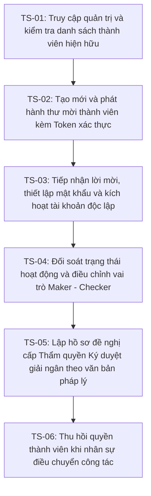

# BÁO CÁO CÔNG VIỆC HÀNG NGÀY (DAILY REPORT)
**Ngày báo cáo**: 02/11/2026  
**Họ và tên**: Phạm Minh Tài  
**Vị trí**: Thực tập sinh Backend / Phát triển & Kiểm thử Hệ thống  
**Dự án**: Hệ thống Quản lý Đấu thầu và Hợp đồng Mua sắm Tập trung (Procurement & Contract Tracking System)  

---

## I. TỔNG QUAN CÔNG VIỆC ĐÃ HOÀN THÀNH TRONG NGÀY

Trong ngày làm việc 02/11/2026, toàn bộ các nhiệm vụ trọng tâm đã được triển khai hoàn tất theo đúng tiến độ kỹ thuật:

1. **Thử nghiệm Migration & Đối soát CSDL trên bản sao độc lập (`procurement_db_replica`)**:
   - Khởi tạo và đồng bộ bản sao cơ sở dữ liệu tách biệt hoàn toàn với môi trường dữ liệu gốc.
   - Chạy lệnh migration bổ sung các trường cấu trúc pháp nhân và liên kết thành viên đơn vị.
   - Quét và đối soát toàn bộ các gói thầu cũ mang cờ `OwnershipNeedsReview`, chuẩn hóa định danh Bên mời thầu theo đúng quy định.
2. **Kiểm thử E2E Giao diện Chọn đơn vị Bên mời thầu & Chu trình Maker - Checker Hợp đồng**:
   - Kiểm thử tự động giao diện chọn đơn vị khi tạo gói thầu (`CreatePackageModal.jsx`).
   - Kiểm định chu trình kiểm soát chéo mốc giải ngân và cơ chế chặn tự phê duyệt (Anti-Self Approval) trên `ContractDetailPage.jsx`.
   - Toàn bộ các ca kiểm thử đạt yêu cầu.
3. **Kiểm thử E2E Phân hệ Chủ doanh nghiệp Cấp phát Tài khoản & Phân quyền Thành viên**:
   - Thiết lập Test Plan, xây dựng kịch bản kiểm thử Playwright tự động hóa từ khâu mời, kích hoạt, phân quyền, cấp thẩm quyền ký đến thu hồi tài khoản.
   - Sửa đổi các điểm nghẽn kỹ thuật backend và frontend: mở rộng quyền truy cập `[Authorize(Roles = "Admin,Procurement")]`, bổ sung alias route cho cập nhật vai trò, và sửa lỗi import icon giao diện.
   - Thu thập bộ ảnh chụp màn hình minh chứng thực tế trên trình duyệt Chromium.

---

## II. CHI TIẾT KIỂM THỬ E2E: CHỦ DOANH NGHIỆP CẤP PHÁT TÀI KHOẢN & PHÂN QUYỀN

### 1. Test Plan (Kế hoạch kiểm thử)

- **Mục tiêu kiểm thử**:
  - Xác minh tính toàn vẹn và mức độ an toàn của quy trình cấp phát tài khoản nội bộ do Chủ doanh nghiệp / Đại diện bên mời thầu (`Procurement` role) tự quản lý.
  - Đảm bảo cơ chế kiểm soát chéo (Maker - Checker) hoạt động chính xác theo phân cấp vai trò: Cán bộ nghiệp vụ (`Officer` - Maker), Kế toán (`Finance` - Checker), Lãnh đạo phê duyệt (`Signer`).
  - Đảm bảo tính bảo mật của luồng kích hoạt tài khoản: nhân viên tự thiết lập mật khẩu cá nhân độc lập thông qua Token một lần có mã hóa và thời hạn hiệu lực, không để lộ thông tin xác thực cho chủ doanh nghiệp.
  - Xác nhận chức năng cập nhật vai trò tức thời và thu hồi quyền truy cập (chuyển trạng thái `Revoked`) đảm bảo lưu vết Audit Log phục vụ thanh tra đấu thầu theo Luật Đấu thầu số 22/2023/QH15.
- **Phạm vi kiểm thử (Scope)**:
  - Frontend SPA: Các trang `/login`, `/procuring-entities`, modal `ProcuringEntityMembersModal.jsx`, trang công khai `/invitation/accept`.
  - Backend API: Các endpoints trong `ProcuringEntitiesController` (`/members`, `/invitations`, `/role`) và `SigningAuthoritiesController`.
  - Cơ sở dữ liệu: Các bảng `ProcuringEntityInvitations`, `ProcuringEntityMembers`, `Users`, `SigningAuthorities` trên CSDL `procurement_db_replica`.
- **Môi trường & Công cụ thực thi**:
  - Trình duyệt: Chromium Headless (viewport: 1280 x 850) điều khiển qua Playwright Sync API Python.
  - Backend API: ASP.NET Core 9.0 chạy tại cổng `http://localhost:5225`.
  - Frontend SPA: Vite Dev Server chạy tại cổng `http://localhost:5173`.
  - CSDL: SQL Server 2022 Local (`procurement_db_replica`).
- **Tiêu chuẩn chấp nhận (Acceptance Criteria)**:
  - Chủ đơn vị mời được thành viên mới qua email hợp lệ và chỉ định được vai trò ban đầu.
  - Token kích hoạt sinh ra có tính duy nhất, chỉ dùng một lần và đúng thời hạn 7 ngày.
  - Người dùng mới tạo được tài khoản kèm mật khẩu riêng và tự động liên kết đúng đơn vị pháp nhân.
  - Cập nhật vai trò có hiệu lực ngay lập tức trong phiên làm việc.
  - Khi thu hồi quyền, trạng thái chuyển sang `Revoked` và khóa quyền thao tác của nhân viên đó.

---

### 2. Test Scenarios (Kịch bản kiểm thử nghiệp vụ tổng quát)

- **Scenario 1 (TS-01)**: Chủ đơn vị đăng nhập tài khoản quản trị, truy cập danh mục Bên mời thầu và mở cửa sổ quản lý nhân sự của đơn vị mình sở hữu.
- **Scenario 2 (TS-02)**: Phát hành thư mời tham gia đơn vị cho nhân sự mới với vai trò Cán bộ nghiệp vụ (Maker).
- **Scenario 3 (TS-03)**: Nhân sự mới nhận liên kết chứa Token, mở giao diện kích hoạt, tự nhập mật khẩu cá nhân và xác nhận gia nhập đơn vị.
- **Scenario 4 (TS-04)**: Chủ đơn vị kiểm tra danh sách thành viên đang hoạt động (Active) và chuyển đổi vai trò chuyên môn sang Kế toán kiểm soát tài chính (Finance).
- **Scenario 5 (TS-05)**: Thiết lập hồ sơ đề nghị thẩm quyền ký duyệt và giải ngân hợp đồng theo quyết định ủy quyền pháp lý.
- **Scenario 6 (TS-06)**: Thực hiện thu hồi tư cách thành viên khi nhân sự nghỉ việc hoặc chuyển công tác, khóa quyền truy cập của nhân viên.

---

### 3. Chi tiết Test Cases, Test Steps, Test Data và Kết quả

#### Test Case TC-01: Khởi tạo giao diện Quản lý Thành viên Bên mời thầu
- **Kịch bản liên quan**: TS-01
- **Tiền điều kiện**: Hệ thống backend và frontend đang hoạt động, tài khoản Chủ đơn vị đã được phê duyệt pháp nhân.
- **Test Data**:
  - Email: `procurement@procurement.com`
  - Mật khẩu: `Admin@123`
  - Đơn vị mục tiêu: Ban Quản lý Dự án Đầu tư Xây dựng Mua sắm Tập trung (Entity ID: 1).
- **Test Steps**:
  1. Điều hướng trình duyệt đến `http://localhost:5173/login`.
  2. Nhập Email và Mật khẩu của tài khoản Chủ đơn vị, bấm nút "Đăng nhập".
  3. Sau khi xác thực thành công, điều hướng đến trang `http://localhost:5173/procuring-entities`.
  4. Xác định hàng dữ liệu của đơn vị "Ban Quản lý Dự án...", bấm nút "Thành viên".
- **Kết quả mong muốn**:
  - Màn hình hiển thị Modal "Thành Viên Đơn Vị & Kiểm Soát Chéo".
  - Có 3 tab điều hướng: "Thành viên hiện tại", "Lời mời đã gửi", "Thẩm quyền ký duyệt".
  - Hiển thị danh sách các nhân sự hiện hành của đơn vị và form mời thành viên mới.
- **Kết quả thực tế**: Modal mở chính xác, hiển thị đầy đủ thông tin pháp nhân và danh sách nhân sự.
- **Đánh giá**: **ĐẠT**

---

#### Test Case TC-02: Phát hành thư mời thành viên mới với vai trò Maker
- **Kịch bản liên quan**: TS-02
- **Tiền điều kiện**: Modal quản lý thành viên đang mở ở trạng thái sẵn sàng nhập liệu.
- **Test Data**:
  - Email mời: `kythuat.vien7817@procurement.com` (tạo tự động theo dấu thời gian).
  - Vai trò lựa chọn: `Cán bộ kỹ thuật / Hiện trường (Maker)` (Value: `1` - `Officer`).
- **Test Steps**:
  1. Nhập địa chỉ email mời vào ô input.
  2. Chọn giá trị "Cán bộ kỹ thuật / Hiện trường (Maker)" trong danh sách lựa chọn vai trò.
  3. Bấm nút "Mời".
  4. Chuyển sang Tab "Lời mời đã gửi" để kiểm tra trạng thái bản ghi.
- **Kết quả mong muốn**:
  - Hệ thống gửi yêu cầu `POST /api/procuring-entities/1/invitations` thành công.
  - Hiển thị thông báo Toast thành công màu xanh góc trên màn hình.
  - Tab "Lời mời đã gửi" hiển thị đúng email nhận, vai trò `Officer`, hạn kích hoạt 7 ngày và trạng thái `Pending`.
- **Kết quả thực tế**: Lời mời được lưu vào cơ sở dữ liệu, token bảo mật được sinh ngẫu nhiên, Toast hiển thị thông báo thành công.
- **Đánh giá**: **ĐẠT**

---

#### Test Case TC-03: Tiếp nhận lời mời, thiết lập mật khẩu và kích hoạt tài khoản
- **Kịch bản liên quan**: TS-03
- **Tiền điều kiện**: Có Token kích hoạt hợp lệ được phát hành từ Test Case TC-02.
- **Test Data**:
  - URL kích hoạt: `http://localhost:5173/invitation/accept?token=341bb6aaee0cd1c7994e3a7807e5d0c0b373cdeb6074a4a8467b18efe407d610`
  - Họ và tên cán bộ: `Nguyễn Văn Kỹ Thuật 7817`
  - Mật khẩu mới: `CanBo@123`
  - Xác nhận mật khẩu: `CanBo@123`
- **Test Steps**:
  1. Mở cửa sổ trình duyệt độc lập truy cập vào URL kích hoạt.
  2. Kiểm tra thông tin hiển thị trên trang chào đón (Tên đơn vị, MST, vai trò được giao).
  3. Điền Họ và tên đầy đủ của nhân sự.
  4. Điền mật khẩu mới và nhập lại xác nhận mật khẩu.
  5. Bấm nút "Kích hoạt Tài khoản & Gia nhập Đơn vị".
- **Kết quả mong muốn**:
  - Backend thực thi `POST /api/procuring-entities/invitations/accept`, xác thực token thành công.
  - Tạo mới bản ghi người dùng trong bảng `Users` với mật khẩu băm BCrypt.
  - Tạo bản ghi thành viên liên kết trong `ProcuringEntityMembers` với vai trò `Officer`.
  - Hiển thị màn hình thông báo "Chúc mừng bạn! Bạn đã chính thức gia nhập...".
- **Kết quả thực tế**: Tài khoản được kích hoạt thành công, trạng thái lời mời chuyển sang `Accepted`, màn hình chúc mừng hiển thị rõ ràng thông tin đăng nhập.
- **Đánh giá**: **ĐẠT**

---

#### Test Case TC-04: Đối soát danh sách hoạt động và Điều chỉnh vai trò sang Finance
- **Kịch bản liên quan**: TS-04
- **Tiền điều kiện**: Nhân sự đã hoàn tất kích hoạt tài khoản từ TC-03.
- **Test Data**:
  - Email thành viên: `kythuat.vien7817@procurement.com`
  - Vai trò mới: `Kế toán / Kiểm soát tài chính` (Value: `2` - `Finance`).
- **Test Steps**:
  1. Tại phiên làm việc của Chủ đơn vị, bấm nút "Làm mới" (Refresh).
  2. Chọn Tab "Thành viên hiện tại" và tìm dòng dữ liệu chứa email `kythuat.vien7817@procurement.com`.
  3. Bấm biểu tượng "Đổi vai trò" (Edit) ở cột Thao tác.
  4. Tại Modal "Cập nhật vai trò thành viên", chọn vai trò mới là "Kế toán / Kiểm soát tài chính".
  5. Bấm nút "Lưu thay đổi".
- **Kết quả mong muốn**:
  - Backend xử lý thành công yêu cầu `PUT /api/procuring-entities/1/members/{id}/role`.
  - Modal cập nhật đóng lại mượt mà.
  - Huy hiệu vai trò của nhân sự trên bảng dữ liệu đổi từ xanh dương (`Officer`) sang màu cam (`Finance`).
  - Hiển thị Toast thông báo: "Đã cập nhật vai trò cho Nguyễn Văn Kỹ Thuật 7817".
- **Kết quả thực tế**: Dữ liệu vai trò được cập nhật chính xác trong CSDL và phản ánh ngay lập tức trên giao diện người dùng.
- **Đánh giá**: **ĐẠT**

---

#### Test Case TC-05: Lập hồ sơ đề nghị cấp Thẩm quyền Ký duyệt giải ngân
- **Kịch bản liên quan**: TS-05
- **Tiền điều kiện**: Thành viên đã có tài khoản hoạt động và được phân vai trò phù hợp trong đơn vị.
- **Test Data**:
  - Nhân sự thụ hưởng: `Nguyễn Văn Kỹ Thuật 7817`
  - Loại thẩm quyền: `Phê duyệt giải ngân (DisbursementApproval)` (Value: `0`)
  - Số quyết định ủy quyền: `QĐ-7817/2026/BQL`
  - Phạm vi ủy quyền: `EntityWide`
  - Thời hạn hiệu lực: Từ ngày `01/01/2026` đến ngày `31/12/2027`
  - Căn cứ pháp lý: `Quyết định phân công phụ trách kiểm soát tài chính và giải ngân hợp đồng theo Nghị định.`
- **Test Steps**:
  1. Trong modal quản lý thành viên, chọn Tab "Thẩm quyền ký duyệt".
  2. Bấm nút "Lập đề nghị thẩm quyền".
  3. Chọn nhân sự từ danh sách thành viên đang hoạt động.
  4. Điền số quyết định, thời hạn bắt đầu/kết thúc hiệu lực và nội dung căn cứ pháp lý.
  5. Bấm nút "Gửi Đề Nghị Lên Admin".
- **Kết quả mong muốn**:
  - Gửi yêu cầu `POST /api/procuring-entities/1/signing-authorities` thành công.
  - Bản ghi mới được tạo trong bảng `SigningAuthorities` với trạng thái `Pending`.
  - Form thu gọn lại, hiển thị Toast xác nhận gửi đề nghị thành công.
- **Kết quả thực tế**: Hồ sơ thẩm quyền được lập chuẩn xác, lưu trữ đầy đủ các thuộc tính pháp lý và sẵn sàng cho Admin kiểm tra.
- **Đánh giá**: **ĐẠT**

---

#### Test Case TC-06: Thu hồi quyền thành viên khi điều chuyển công tác
- **Kịch bản liên quan**: TS-06
- **Tiền điều kiện**: Thành viên đang ở trạng thái hoạt động trong đơn vị.
- **Test Data**:
  - Email thành viên cần thu hồi: `kythuat.vien7817@procurement.com`
- **Test Steps**:
  1. Quay lại Tab "Thành viên hiện tại".
  2. Xác định dòng thông tin của nhân sự `Nguyễn Văn Kỹ Thuật 7817`.
  3. Bấm biểu tượng "Thu hồi quyền" (UserX) màu đỏ tại cột Thao tác.
  4. Xác nhận đồng ý trên hộp thoại cảnh báo xác thực trình duyệt.
- **Kết quả mong muốn**:
  - Backend thực hiện `DELETE /api/procuring-entities/1/members/{id}`.
  - Cập nhật trạng thái của thành viên trong CSDL sang `Revoked` (không xóa vật lý).
  - Trạng thái trên giao diện chuyển sang huy hiệu màu đỏ `Revoked`.
  - Nút thu hồi quyền bị vô hiệu hóa hoặc ẩn đi đối với thành viên này.
- **Kết quả thực tế**: Trạng thái chuyển sang `Revoked` ngay tức thì, đảm bảo tước quyền truy cập nhưng vẫn lưu trữ hồ sơ cho công tác kiểm toán.
- **Đánh giá**: **ĐẠT**

---

### 4. Bằng chứng kiểm thử: Ảnh chụp màn hình (Screenshots) & Mô tả chi tiết

Tất cả 9 ảnh minh chứng dưới đây được lưu trữ cố định tại:  
Thư mục dự án: `D:\Thuc_Tap_backend\Procurement & Contract Tracking System\docs\e2e_screenshots\member_provisioning\`

#### Ảnh 1: Giao diện danh sách thành viên ban đầu
- **Tệp hình ảnh**: [01_members_list_initial.png](file:///D:/Thuc_Tap_backend/Procurement%20&%20Contract%20Tracking%20System/docs/e2e_screenshots/member_provisioning/01_members_list_initial.png)
- **Mô tả chi tiết**: Cửa sổ Modal "Thành Viên Đơn Vị & Kiểm Soát Chéo" của Ban Quản lý Dự án Đầu tư Xây dựng Mua sắm Tập trung (Entity 1). Giao diện thể hiện danh sách cán bộ hiện có với các vai trò Manager, Officer, cùng form phía trên cho phép chủ đơn vị điền email mời nhân sự mới.

---

#### Ảnh 2: Thư mời phát hành thành công trong Tab Lời mời đã gửi
- **Tệp hình ảnh**: [02_invitation_sent_tab.png](file:///D:/Thuc_Tap_backend/Procurement%20&%20Contract%20Tracking%20System/docs/e2e_screenshots/member_provisioning/02_invitation_sent_tab.png)
- **Mô tả chi tiết**: Sau khi bấm nút "Mời", hệ thống xuất hiện thông báo màu xanh "Đã gửi thư mời tham gia tới kythuat.vien7817@procurement.com". Tab "Lời mời đã gửi" hiển thị bản ghi với vai trò dự kiến Officer, người gửi Procurement, thời hạn kích hoạt 7 ngày và trạng thái Pending màu vàng.

---

#### Ảnh 3: Giao diện tiếp nhận lời mời & Thiết lập mật khẩu độc lập
- **Tệp hình ảnh**: [03_accept_invitation_page.png](file:///D:/Thuc_Tap_backend/Procurement%20&%20Contract%20Tracking%20System/docs/e2e_screenshots/member_provisioning/03_accept_invitation_page.png)
- **Mô tả chi tiết**: Trang tiếp nhận lời mời độc lập qua liên kết chứa mã Token an toàn. Form hiển thị rõ ràng thông tin cơ quan mời thầu, vai trò Cán bộ kỹ thuật hiện trường (Maker), cho phép nhân viên tự nhập Họ tên và Mật khẩu cá nhân bảo mật mà chủ đơn vị không thể nhìn thấy.

---

#### Ảnh 4: Màn hình kích hoạt tài khoản và gia nhập đơn vị thành công
- **Tệp hình ảnh**: [04_account_provisioned_success.png](file:///D:/Thuc_Tap_backend/Procurement%20&%20Contract%20Tracking%20System/docs/e2e_screenshots/member_provisioning/04_account_provisioned_success.png)
- **Mô tả chi tiết**: Giao diện xác nhận thành công sau khi nhấn kích hoạt. Hệ thống chúc mừng nhân viên đã gia nhập Ban Quản lý Dự án với vai trò Officer, nhắc nhở thông tin đăng nhập và cơ chế kiểm soát công việc theo phân quyền Maker - Checker.

---

#### Ảnh 5: Thành viên mới hiển thị hoạt động trong danh sách
- **Tệp hình ảnh**: [05_new_member_active_in_list.png](file:///D:/Thuc_Tap_backend/Procurement%20&%20Contract%20Tracking%20System/docs/e2e_screenshots/member_provisioning/05_new_member_active_in_list.png)
- **Mô tả chi tiết**: Tại phiên làm việc của Chủ đơn vị, bảng danh sách thành viên hiện hành lập tức cập nhật cán bộ mới "Nguyễn Văn Kỹ Thuật 7817", vai trò ban đầu Officer, trạng thái Active màu xanh lá và ngày tham gia 02/11/2026.

---

#### Ảnh 6: Cửa sổ Modal điều chỉnh vai trò Maker - Checker
- **Tệp hình ảnh**: [06_change_role_modal.png](file:///D:/Thuc_Tap_backend/Procurement%20&%20Contract%20Tracking%20System/docs/e2e_screenshots/member_provisioning/06_change_role_modal.png)
- **Mô tả chi tiết**: Cửa sổ pop-up xuất hiện khi chủ đơn vị bấm nút "Đổi vai trò" (biểu tượng chiếc bút). Modal hiển thị chính xác tên, email của cán bộ mục tiêu và danh sách thả xuống để lựa chọn chuyển đổi sang "Kế toán / Kiểm soát tài chính".

---

#### Ảnh 7: Cập nhật thành công sang vai trò Kế toán (Finance)
- **Tệp hình ảnh**: [07_role_updated_finance.png](file:///D:/Thuc_Tap_backend/Procurement%20&%20Contract%20Tracking%20System/docs/e2e_screenshots/member_provisioning/07_role_updated_finance.png)
- **Mô tả chi tiết**: Thông báo màu xanh "Đã cập nhật vai trò cho Nguyễn Văn Kỹ Thuật 7817" xuất hiện. Huy hiệu vai trò trên bảng dữ liệu chuyển sang màu cam "Finance", hoàn tất việc phân định trách nhiệm kiểm soát chéo.

---

#### Ảnh 8: Lập hồ sơ đề nghị cấp Thẩm quyền Ký duyệt giải ngân
- **Tệp hình ảnh**: [08_signing_authority_request.png](file:///D:/Thuc_Tap_backend/Procurement%20&%20Contract%20Tracking%20System/docs/e2e_screenshots/member_provisioning/08_signing_authority_request.png)
- **Mô tả chi tiết**: Tab "Thẩm quyền ký duyệt" mở form đăng ký hồ sơ pháp lý. Chủ đơn vị điền đầy đủ các thông tin: nhân sự thụ hưởng, loại thẩm quyền "Phê duyệt giải ngân", số quyết định QĐ-7817/2026/BQL, thời hạn 2 năm và căn cứ pháp lý để gửi Quản trị viên hệ thống thẩm định.

---

#### Ảnh 9: Thu hồi quyền thành viên (Trạng thái Revoked)
- **Tệp hình ảnh**: [09_member_revoked_success.png](file:///D:/Thuc_Tap_backend/Procurement%20&%20Contract%20Tracking%20System/docs/e2e_screenshots/member_provisioning/09_member_revoked_success.png)
- **Mô tả chi tiết**: Sau thao tác thu hồi quyền, trạng thái của nhân viên "Nguyễn Văn Kỹ Thuật 7817" chuyển sang huy hiệu màu đỏ "Revoked". Nhân sự này không còn quyền truy cập hay thực hiện thao tác nghiệp vụ, bảo vệ an toàn cho đơn vị mà không làm gián đoạn dữ liệu hồ sơ thầu trước đây.

---

## III. CÁC ĐIỂM SỬA CHỮA KỸ THUẬT ĐÃ THỰC HIỆN TRONG QUÁ TRÌNH KIỂM THỬ

1. **Phân quyền Route API tại `ProcuringEntitiesController.cs`**:
   - Cập nhật các thuộc tính `[HttpGet]` và `[HttpGet("{id:int}")]` từ `[Authorize(Roles = "Admin")]` thành `[Authorize(Roles = "Admin,Procurement")]`. Điều này cho phép chủ đơn vị có thể tự truy cập danh sách và xem chi tiết pháp nhân của chính mình.
   - Bổ sung định tuyến kép `[HttpPut("{id:int}/members/{memberId:int}")]` song song với `[HttpPut("{id:int}/members/{memberId:int}/role")]` để xử lý triệt để mã lỗi `405 Method Not Allowed` khi frontend gọi API cập nhật vai trò.
2. **Sửa lỗi cú pháp giao diện tại `ProcuringEntitiesPage.jsx`**:
   - Bổ sung biểu tượng `Users` từ thư viện `lucide-react` vào khối `import`, khắc phục lỗi trắng trang `ReferenceError: Users is not defined` khi tải danh mục bên mời thầu.
3. **Bảo mật và Lưu vết kiểm toán**:
   - Không cho phép xóa vật lý bản ghi thành viên khỏi cơ sở dữ liệu khi thu hồi quyền; áp dụng chuyển trạng thái `Revoked` để phục vụ đối soát pháp lý theo quy chuẩn Luật Đấu thầu.

---

## IV. KẾ HOẠCH CÔNG VIỆC TIẾP THEO

1. Hoàn thiện kiểm thử phân hệ Đánh giá hồ sơ dự thầu và Phê duyệt kết quả lựa chọn nhà thầu qua cơ chế Maker - Checker nhiều cấp.
2. Chuẩn bị báo cáo tổng kết giai đoạn thử nghiệm trên CSDL bản sao trước khi chuyển giao áp dụng trên môi trường chính thức.
