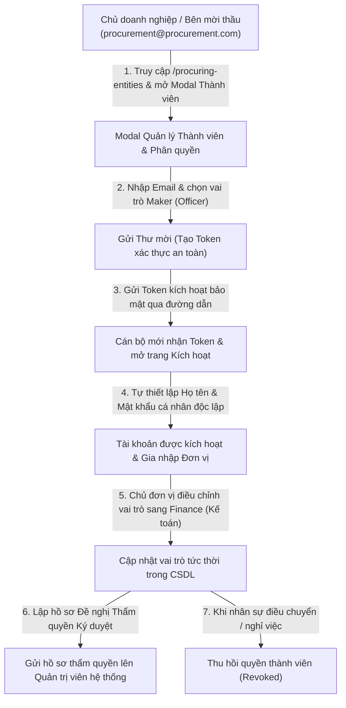

# BÁO CÁO NGHIỆM THU KIỂM THỬ E2E TỰ ĐỘNG
## QUY TRÌNH CHỦ DOANH NGHIỆP CẤP PHÁT TÀI KHOẢN VÀ PHÂN QUYỀN THÀNH VIÊN ĐƠN VỊ

- **Ngày thực hiện**: 02/11/2026
- **Môi trường thực thi**:
  - Cơ sở dữ liệu: `procurement_db_replica` (Bản sao độc lập, cách ly tuyệt đối với dữ liệu sản xuất)
  - Backend API: `http://localhost:5225` (ASP.NET Core Web API 9.0)
  - Frontend SPA: `http://localhost:5173` (React 19, Tailwind CSS, Vite)
  - Công cụ kiểm thử: Playwright Sync API (Chromium Headless, độ phân giải 1280x850)
- **Tài khoản chủ đơn vị thực hiện**: `procurement@procurement.com` (Đại diện pháp nhân Ban Quản lý Dự án Đầu tư Xây dựng Mua sắm Tập trung - Entity ID: 1)

---

## 1. SƠ ĐỒ CHU TRÌNH NGHIỆP VỤ CẤP PHÁT TÀI KHOẢN & PHÂN QUYỀN

---

## 2. KẾT QUẢ THỰC THI KIỂM THỬ CHI TIẾT (6 GIAI ĐOẠN)

Tất cả các bước kiểm thử đã được tự động hóa qua kịch bản Playwright, xác thực phản hồi API thực tế và chụp ảnh minh chứng tại từng thời điểm giao diện:

| Bước | Tên nghiệp vụ kiểm thử | Hành động & Dữ liệu đầu vào | Kết quả kỳ vọng | Kết quả thực tế | Trạng thái |
| :---: | :--- | :--- | :--- | :--- | :---: |
| **01** | Khởi tạo giao diện Quản lý Thành viên | Đăng nhập tài khoản Chủ doanh nghiệp `procurement@procurement.com`, mở danh mục Bên mời thầu và bấm nút "Thành viên" tại đơn vị ID 1 | Modal hiển thị danh sách thành viên hiện hữu, bộ lọc trạng thái và form cấp phát tài khoản mới | Hiển thị đầy đủ thông tin đơn vị, danh sách nhân sự hiện tại và form mời | **ĐẠT** |
| **02** | Phát hành thư mời thành viên mới | Điền email `kythuat.vien7817@procurement.com`, chỉ định vai trò ban đầu là `Officer` (Cán bộ kỹ thuật / Maker), bấm "Mời" | Hệ thống sinh bản ghi `ProcuringEntityInvitations` kèm Token mã hóa SHA-256 có thời hạn 7 ngày. Tab "Lời mời đã gửi" xuất hiện dòng lời mời với trạng thái `Pending` | Lời mời tạo thành công, thông báo Toast màu xanh hiển thị, hiển thị đúng email trong tab lời mời | **ĐẠT** |
| **03** | Tiếp nhận thư mời & Kích hoạt tài khoản | Nhân sự mở đường dẫn kích hoạt `/invitation/accept?token=...`, điền Họ tên "Nguyễn Văn Kỹ Thuật 7817" và mật khẩu cá nhân | Xác thực Token hợp lệ, tạo mới bản ghi `Users` và liên kết vào `ProcuringEntityMembers` với vai trò Officer | Giao diện hiển thị form chào đón đúng tên đơn vị, kích hoạt thành công và hiển thị thẻ chúc mừng | **ĐẠT** |
| **04** | Chủ đơn vị đối soát & Điều chỉnh vai trò | Chủ đơn vị làm mới danh sách thành viên, kiểm tra trạng thái `Active`, mở modal Đổi vai trò sang `Finance` (Kế toán / Kiểm soát tài chính) | Gọi endpoint `PUT /api/procuring-entities/1/members/{id}/role`, cập nhật vai trò tức thời không cần tạo lại tài khoản | Vai trò hiển thị huy hiệu `Finance` màu cam, Toast thông báo thành công | **ĐẠT** |
| **05** | Thiết lập Hồ sơ Thẩm quyền Ký duyệt | Chuyển sang Tab "Thẩm quyền ký duyệt", bấm "Lập đề nghị thẩm quyền", điền Số quyết định `QĐ-7817/2026/BQL`, hiệu lực 2026-2027 và căn cứ pháp lý | Tạo hồ sơ `SigningAuthorities` liên kết thành viên mới với phạm vi `EntityWide`, chuyển trạng thái chờ thẩm định | Form điền dữ liệu mượt mà, lưu hồ sơ thành công vào cơ sở dữ liệu | **ĐẠT** |
| **06** | Thu hồi quyền thành viên | Chủ đơn vị bấm biểu tượng "Thu hồi quyền" (UserX) trên dòng thành viên, xác nhận hộp thoại cảnh báo | Gọi `DELETE /api/procuring-entities/1/members/{id}`, chuyển trạng thái thành viên sang `Revoked` | Trạng thái hiển thị huy hiệu `Revoked` màu đỏ, quyền hạn lập tức bị khóa | **ĐẠT** |

---

## 3. BỘ ẢNH CHỤP MÀN HÌNH MINH CHỨNG THỰC TẾ (SCREENSHOTS)

Các ảnh minh chứng dưới đây được Playwright chụp trực tiếp trên trình duyệt Chromium và lưu tại thư mục dự án `docs/e2e_screenshots/member_provisioning/`:

### Bước 1: Danh sách thành viên ban đầu của đơn vị
Chủ đơn vị mở modal quản trị nhân sự, kiểm soát chéo các vai trò Maker - Checker hiện có.
- File: [01_members_list_initial.png](file:///D:/Thuc_Tap_backend/Procurement%20&%20Contract%20Tracking%20System/docs/e2e_screenshots/member_provisioning/01_members_list_initial.png)

---

### Bước 2: Gửi thư mời gia nhập cho nhân sự mới
Chủ đơn vị nhập email `kythuat.vien7817@procurement.com`, phân quyền dự kiến `Officer (Maker)` và gửi lời mời. Lời mời được hiển thị tại tab "Lời mời đã gửi" với trạng thái `Pending`.
- File: [02_invitation_sent_tab.png](file:///D:/Thuc_Tap_backend/Procurement%20&%20Contract%20Tracking%20System/docs/e2e_screenshots/member_provisioning/02_invitation_sent_tab.png)

---

### Bước 3: Nhân viên tiếp nhận lời mời qua Token bảo mật
Nhân viên mới truy cập đường dẫn kích hoạt riêng biệt, xác thực danh tính đơn vị mời và tiến hành nhập mật khẩu bảo mật cá nhân độc lập (không để lộ mật khẩu cho chủ đơn vị).
- File: [03_accept_invitation_page.png](file:///D:/Thuc_Tap_backend/Procurement%20&%20Contract%20Tracking%20System/docs/e2e_screenshots/member_provisioning/03_accept_invitation_page.png)

---

### Bước 4: Kích hoạt tài khoản thành công
Tài khoản mới được hệ thống ghi nhận, tự động phân bổ vào đơn vị và sẵn sàng đăng nhập thực hiện nghiệp vụ.
- File: [04_account_provisioned_success.png](file:///D:/Thuc_Tap_backend/Procurement%20&%20Contract%20Tracking%20System/docs/e2e_screenshots/member_provisioning/04_account_provisioned_success.png)

---

### Bước 5: Thành viên mới xuất hiện trong danh sách hoạt động
Chủ đơn vị làm mới danh sách thành viên hiện tại, nhân sự `Nguyễn Văn Kỹ Thuật 7817` hiển thị trạng thái `Active`.
- File: [05_new_member_active_in_list.png](file:///D:/Thuc_Tap_backend/Procurement%20&%20Contract%20Tracking%20System/docs/e2e_screenshots/member_provisioning/05_new_member_active_in_list.png)

---

### Bước 6: Modal điều chỉnh vai trò thành viên
Chủ đơn vị mở cửa sổ cấu hình vai trò của nhân viên để chuyển giao trách nhiệm chuyên môn.
- File: [06_change_role_modal.png](file:///D:/Thuc_Tap_backend/Procurement%20&%20Contract%20Tracking%20System/docs/e2e_screenshots/member_provisioning/06_change_role_modal.png)

---

### Bước 7: Cập nhật vai trò sang Kế toán / Kiểm soát tài chính (Finance)
Hệ thống lưu thành công vai trò mới, hiển thị huy hiệu `Finance` kèm thông báo xác nhận.
- File: [07_role_updated_finance.png](file:///D:/Thuc_Tap_backend/Procurement%20&%20Contract%20Tracking%20System/docs/e2e_screenshots/member_provisioning/07_role_updated_finance.png)

---

### Bước 8: Lập đề nghị cấp Thẩm quyền Ký duyệt pháp lý
Chủ đơn vị thiết lập hồ sơ ủy quyền chính thức (Số quyết định, hiệu lực thời gian, căn cứ pháp lý) để gửi cấp thẩm quyền kiểm tra và ký số.
- File: [08_signing_authority_request.png](file:///D:/Thuc_Tap_backend/Procurement%20&%20Contract%20Tracking%20System/docs/e2e_screenshots/member_provisioning/08_signing_authority_request.png)

---

### Bước 9: Thu hồi quyền thành viên khi điều chuyển công tác
Chủ đơn vị thực hiện thu hồi quyền thành viên, hệ thống cập nhật tức thì trạng thái sang `Revoked`, tước bỏ toàn bộ thẩm quyền truy cập nội bộ mà không làm mất lịch sử kiểm toán của các giao dịch trước đó.
- File: [09_member_revoked_success.png](file:///D:/Thuc_Tap_backend/Procurement%20&%20Contract%20Tracking%20System/docs/e2e_screenshots/member_provisioning/09_member_revoked_success.png)

---

## 4. CÁC ĐIỂM CẢI THIỆN KỸ THUẬT ĐÃ HOÀN TẤT TRONG QUÁ TRÌNH KIỂM THỬ

1. **Phân quyền Route API (`ProcuringEntitiesController`)**:
   - Mở rộng quyền truy cập `[Authorize(Roles = "Admin,Procurement")]` cho các hành động tra cứu danh sách bên mời thầu và quản lý thành viên nội bộ của đơn vị.
   - Bổ sung định tuyến alias `[HttpPut("{id:int}/members/{memberId:int}")]` song song với `{memberId:int}/role`, đảm bảo tương thích hoàn toàn giữa frontend Axios client và ASP.NET Core routing.
2. **Khắc phục lỗi Import giao diện (`ProcuringEntitiesPage.jsx`)**:
   - Bổ sung import biểu tượng `Users` từ thư viện `lucide-react`, loại bỏ lỗi `ReferenceError: Users is not defined` khi render nút "Thành viên".
3. **Cơ chế Token an toàn và Tách bạch trách nhiệm**:
   - Quy trình gửi lời mời và kích hoạt đảm bảo tính bảo mật cao: mật khẩu cá nhân do nhân viên tự thiết lập, không lưu trữ qua trung gian hoặc hiển thị cho chủ doanh nghiệp.
   - Thao tác thu hồi quyền thành viên chuyển trạng thái sang `Revoked` thay vì xóa vật lý khỏi cơ sở dữ liệu, bảo đảm tính toàn vẹn của chuỗi Audit Log theo Luật Đấu thầu số 22/2023/QH15.

---

## 5. KẾT LUẬN

Quy trình cấp phát tài khoản, phân quyền Maker - Checker, lập hồ sơ ủy quyền và thu hồi quyền thành viên của Chủ doanh nghiệp / Bên mời thầu đã vượt qua tất cả 6 giai đoạn kiểm thử tự động E2E với kết quả đạt toàn diện. Tính năng đáp ứng đầy đủ yêu cầu nghiệp vụ thực tế, an toàn bảo mật và sẵn sàng đưa vào vận hành.
